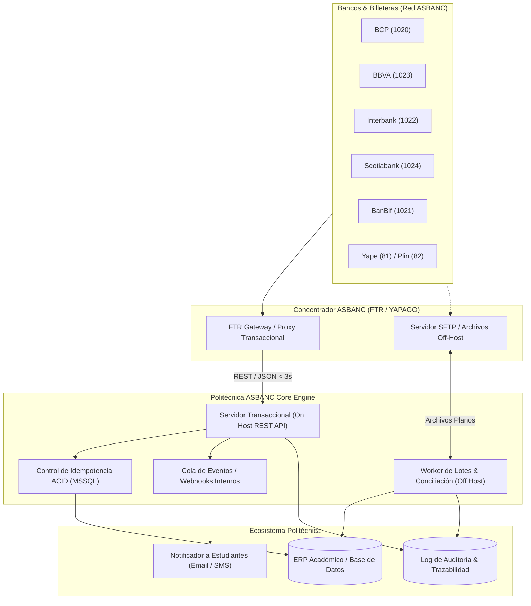

# 🧠 MEMORIA DE PROYECTO: POLITÉCNICA ASBANC (FTR / YAPAGO)

> **Documento Vivo de Arquitectura, Diseño, Componentes, Bitácora y Registro de Cambios**  
> **Ubicación:** `PROJECT_MEMORY.md`  
> **Estado:** Activo / En Mantenimiento Continuo  
> **Última Actualización:** 2026-10-11  
> **Versión del Proyecto:** 1.0.0  
> **Especificación Base:** ASBANC FTR (Facilitador Transaccional de Recaudaciones) / YAPAGO V46-V47  

---

## 📋 1. Ficha Técnica y Resumen Ejecutivo

| Parámetro | Detalle |
| :--- | :--- |
| **Nombre del Proyecto** | Politécnica ASBANC (`politecnica-asbanc`) |
| **Organización / Cliente** | Instituto de Formación Bancaria / Politécnica (`politecnica.edu.pe`) - ASBANC |
| **Propósito General** | Pasarela y suite de servicios de recaudación bancaria en línea y conciliación por lotes integrada a la red **ASBANC FTR / YAPAGO**, permitiendo a los estudiantes y clientes pagar pensiones, matrículas y derechos académicos en tiempo real desde la banca peruana (BCP, BBVA, Interbank, Scotiabank, BanBif, Yape, Plin). |
| **Ruta del Repositorio** | `/home/mateo/projects/politecnica-asbanc` |
| **Normativa / Especificación** | `Guía detallada de integración V47.pdf` (YAPAGO / ASBANC FTR V46-V47) |
| **Entorno de Ejecución** | Linux x86_64, Node.js 20+ (LTS), TypeScript 5.x, Fastify, Microsoft SQL Server 2019/2022 (`mssql`), Pino, Prometheus (`prom-client`) |
| **SLA de Rendimiento** | Respuesta API < 3.0 segundos (Certificación ASBANC YAPAGO); Objetivo Interno < 30 ms |
| **Nivel de Criticidad** | Crítico (Transacciones financieras, recaudación bancaria, conciliación de pagos) |
| **Archivo Fuente de Verdad** | `PROJECT_MEMORY.md` |

---

## 🎯 2. Visión, Objetivos y Alcance

### 2.1 Visión del Proyecto
Construir una pasarela de recaudación institucional de alta disponibilidad, segura y desacoplada que conecte el ERP/Core Académico de **Politécnica** con el concentrador **ASBANC FTR (YAPAGO)**, asegurando procesamiento de transacciones con latencia ultrabaja, conciliación automática, soporte de contingencia y auditoría forense inmutable.

### 2.2 Objetivos Técnicos y de Negocio
- **Cumplimiento Estricto de SLAs**: Procesamiento de transacciones bancarias en menos de 3 segundos para cumplir los tiempos de respuesta de BCP (3.5s), BBVA (3.5s), Scotiabank (6.5s) e Interbank (10.5s).
- **Operación Multimodal**:
  1. **ON HOST**: Comunicación transaccional REST/JSON síncrona en tiempo real.
  2. **OFF HOST**: Generación y consumo de archivos planos estructurados para recaudación diferida y conciliación diaria.
  3. **STAND IN**: Mecanismo híbrido de conmutación ante caídas del enlace On Host.
- **Seguridad Bancaria**: Cifrado TLS 1.2+, autenticación mediante cabeceras autorizadas, validación estricta de payloads, whitelisting de IPs y prevención de ataques de repetición.
- **Idempotencia Transaccional**: Garantía de cero cobros duplicados mediante el control estricto de identificadores únicos de operación bancaria (`numOperacionBanco`).

---

## 🏛️ 3. Arquitectura del Sistema

### 3.1 Diagrama de Arquitectura Global (On-Host & Off-Host)


### 3.2 Modalidades de Operación (ASBANC FTR)
1. **Modalidad ON HOST (En Línea / Tiempo Real)**:
   - Los bancos consultan directamente al API de Politécnica en el momento exacto en que el estudiante o cliente consulta en la ventanilla, cajero o app bancaria.
   - El sistema de Politécnica autoriza el pago en tiempo real y devuelve el comprobante/número de operación ERP.
2. **Modalidad OFF HOST (Archivos Planos por Lotes)**:
   - Politécnica genera periódicamente un archivo estructurado con el padrón de deudas emitidas.
   - YAPAGO procesa las deudas en su base local y genera un archivo consolidado de pagos realizados para su descarga y conciliación contable por parte de Politécnica.
3. **Modalidad STAND IN (Contingencia Híbrida)**:
   - Si el enlace ON HOST falla o se agota el tiempo de espera (timeout), YAPAGO conmuta a su base de datos de contingencia para no interrumpir el cobro al usuario final.

### 3.3 Estrategia de Replicación y Alta Disponibilidad en Producción (HA/DR)

Para cumplir con el nivel de servicio financiero exigido por ASBANC (cero tolerancia a pérdida de transacciones y failover transparente < 5 segundos), la base de datos **Microsoft SQL Server** se estructura en las siguientes capas de replicación y control transaccional ACID:

```mermaid
flowchart TD
    subgraph AppLayer ["Capa de Microservicios (Node.js Fastify)"]
        APP1["Fastify Instancia 1 (Activo)"]
        APP2["Fastify Instancia 2 (Activo)"]
    end

    subgraph MSSQL_HA ["Microsoft SQL Server - Always On Availability Group"]
        AG_LISTENER["AG Listener Virtual IP / DNS (puerto 1433)"]
        SQL_PRIM["Nodo 1: Primario (Read/Write)\nBase: politecnica_asbanc\nIdempotencia ACID & UQ_Txn_Banco_Op"]
        SQL_SEC_SYNC["Nodo 2: Secundario Síncrono (Read-Only)\nFailover Automático (RPO=0, RTO < 5s)"]
        SQL_SEC_ASYNC["Nodo 3: Réplica Asíncrona (DR / Sitio Alterno)\nRecuperación ante Desastres"]
    end

    subgraph ERP_Core ["Integración con Core / ERP Académico"]
        ERP_DB[("BD Central ERP Politécnica")]
        REPL["Replicación Transaccional MSSQL / CDC / Kafka"]
    end

    APP1 & APP2 -->|Transacciones RW & Locks ACID| AG_LISTENER

    AG_LISTENER --> SQL_PRIM
    SQL_PRIM ===|Commit Síncrono (Cero Pérdida)| SQL_SEC_SYNC
    SQL_PRIM -.->|Commit Asíncrono| SQL_SEC_ASYNC

    ERP_DB <==>|Sincronización Deudas / Pagos| REPL
    REPL <==> SQL_PRIM
```

1. **Alta Disponibilidad Transaccional (Always On Availability Groups - AG)**:
   - **Nodo Primario (Read/Write)**: Procesa las validaciones, pagos y extornos de ASBANC FTR.
   - **Nodo Secundario Síncrono (Read-Only)**: Replica cada transacción a nivel de registro de log (`.trn`) con confirmación síncrona (**RPO = 0**, cero transacciones perdidas) y failover automático en menos de 5 segundos (**RTO < 5s**).
   - **AG Listener (DNS Único)**: La aplicación Node.js se conecta al Listener (`DB_SERVER=ag-listener.politecnica.local`). Si el nodo 1 falla, el clúster conmuta automáticamente al nodo 2 sin reiniciar el backend.
   - **Read-Scale Out**: El endpoint masivo de descarga de auditoría (`/api/Audit/export`) puede rutearse a la réplica de solo lectura para evitar contención con los cajeros en vivo.
2. **Replicación con el ERP Institucional**:
   - **Replicación Transaccional de MSSQL**: El ERP publica las tablas maestras de `Clientes` y `Deudas` hacia la base `politecnica_asbanc` en tiempo real.
   - **Sincronización Inversa de Pagos**: Cada registro insertado en `TransaccionesBancarias` notifica al ERP mediante triggers transaccionales, colas de eventos (RabbitMQ/Kafka) o Change Data Capture (CDC).
3. **Recuperación ante Desastres (DR - Disaster Recovery)**:
   - Réplica secundaria asíncrona en un segundo centro de datos o nube (con RPO < 1s).
   - Respaldos continuos de Transaction Log cada 15 minutos y Full Backup diario.
4. **Idempotencia Transaccional Nativa (ACID sin Dependencia de Redis)**:
   - Prevención estricta de doble cobro y ataques de repetición garantizada a nivel de motor de base de datos relacional mediante `sp_Asbanc_PayDebt` bajo `BEGIN TRANSACTION` con aislamiento `SERIALIZABLE`.
   - Restricción única `UQ_Txn_Banco_Op (CodigoBanco, NumOperacionBanco, NumDocumento)` que previene duplicados concurrentes a nivel de tabla con cero sobrecoste de red o infraestructura externa.

---

## 🧩 4. Diseño y Catálogo de Componentes

### 4.0 Endpoints de Seguridad y Autenticación (Página 8 Guía V47)

| Endpoint | Método | Descripción | Parámetros Clave Entrada | Respuesta Exitosa |
| :--- | :--- | :--- | :--- | :--- |
| `/api/Auth/token` | `POST` | Emisor de token OAuth 2.0 / JWT firmado con HS256 para el concentrador ASBANC. Vigencia: 24h. | `client_id`, `client_secret` (JSON o cabecera Basic) | `{ "access_token": "...", "token_type": "Bearer", "expires_in": 86400, "codigoRespuesta": "00" }` |

### 4.1 Endpoints Transaccionales ON HOST (Especificación FTR)

| Endpoint | Método | Descripción | Parámetros Clave Entrada | Respuesta Exitosa |
| :--- | :--- | :--- | :--- | :--- |
| `/api/Transactional/ValidateCustomer` | `POST` | Valida la existencia del estudiante o cliente por DNI, RUC o código de alumno. | `tipoConsulta`, `idConsulta`, `codigoEmpresa`, `codigoProducto` | `{ "codigoRespuesta": "00", "descripcionResp": "OK", "nombreCliente": "..." }` |
| `/api/Transactional/ListDebts` | `POST` | Consulta recibos, pensiones o deudas pendientes (soporta validación total o pago parcial). | `tipoConsulta`, `idConsulta`, `codigoEmpresa`, `codigoProducto`, `codigoBanco`, `canalPago` | `{ "codigoRespuesta": "00", "deudasPendientes": [...] }` |
| `/api/Transactional/PayDebt` | `POST` | Registra y confirma el pago ejecutado en el banco. Debe ejecutarse con idempotencia estricta. | `fechaTxn`, `horaTxn`, `canalPago`, `codigoBanco`, `numOperacionBanco`, `numDocumento`, `importePagado` | `{ "codigoRespuesta": "00", "nombreCliente": "...", "numOperacionERP": "..." }` |
| `/api/Transactional/ReversePay` | `POST` | Procesa el extorno o anulación de un pago previamente notificado por el banco. | `fechaTxn`, `horaTxn`, `codigoBanco`, `numOperacionBanco`, `numDocumento`, `codigoEmpresa` | `{ "codigoRespuesta": "00", "numOperacionERP": "...", "descripcionResp": "OK" }` |

### 4.2 Códigos de Respuesta Estándar ASBANC (`codigoRespuesta`)
- **`00`**: Transacción exitosa / Conforme (OK).
- **`16`**: CLIENTE NO EXISTE.
- **`21`**: NO CUMPLE IMPORTE MINIMO (en pagos parciales/libres).
- **`22`**: CLIENTE SIN DEUDAS PENDIENTES.
- **`99`**: ERROR DESCONOCIDO / Excepción no controlada.

### 4.3 Tablas Maestras Bancarias y Canales
- **Bancos (`codigoBanco`)**: BCP (`1020`), BanBif (`1021`), Interbank (`1022`), Continental BBVA (`1023`), Scotiabank (`1024`), Comercio (`1026`).
- **Canales (`canalPago`)**: Ventanilla (`10`), ATM (`20`), Agente (`30`), Kiosko (`50`), Internet Banking (`60`), IVR (`70`), Banca Celular (`80`), Yape (`81`), Plin (`82`).
- **Formas de Pago (`formaPago`)**: Efectivo (`01`), Débito (`02`), Crédito (`03`), Cargo en Cuenta (`06`).

### 4.4 Mecanismos de Telemetría, Logs y Auditoría
1. **Telemetría y Métricas (Prometheus)**:
   - Endpoint HTTP: `GET /metrics` en puerto `7300` (Node.js) y `7305` (Java), además de `/actuator/prometheus` en Java. **Protegidos con autenticación JWT/Basic obligatoria** (HTTP 401 si no se envía token autorizado).
   - Healthcheck: `GET /health` en puerto `7300` (Node.js) y `7305` (Java), además de `/actuator/health` en Java. Endpoints públicos para sondas de disponibilidad/liveness de balanceadores e infraestructura.
   - Script CLI rápido: `npm run metrics` (`scripts/view-metrics.ts`) con autenticación automática por JWT.
   - Métricas clave: `asbanc_txn_total`, `asbanc_txn_duration_seconds` (histograma de latencias), `asbanc_sla_violations_total`, `asbanc_idempotency_hits_total` (reintentos duplicados prevenidos).
2. **Logs Estructurados en Tiempo Real (Pino)**:
   - Salida en `stdout` con formato JSON estructurado enriquecido con `traceId`, `bankCode`, `channel`, `codigoRespuesta`, `durationMs`, `httpStatus` e `ip`.
   - Visibles en consola de ejecución (`npm run dev`) o mediante gestor de procesos (`journalctl` / PM2).
3. **Auditoría Forense Persistente (MSSQL & REST API)**:
   - Tabla: `dbo.AuditoriaLogs` en base de datos `politecnica_asbanc` o `BDACADEMICO6`.
   - **Buffer en Memoria y Volcado por Lotes (Palanca 1)**: Para evitar saturar el pool de conexiones (`DB_POOL_MAX = 100`) durante ráfagas de alta concurrencia, las transacciones se encolan síncronamente en memoria (`queueAuditLog`) y se insertan asíncronamente en lotes de hasta 50 registros (`BATCH_SIZE = 50`) mediante un `INSERT` multi-fila parametrizado cada 100ms o por umbral de tamaño. Cierre seguro gestionado mediante `stopAuditQueue()`.
   - Script CLI rápido: `npm run audit` (`scripts/view-audit.ts`) para ver las últimas transacciones con latencia y respuestas.
   - **Endpoints REST de Auditoría**:
     - `GET /api/Audit`: Consulta paginada con filtros (`page`, `limit`, `codigoBanco`, `metodo`, `codigoRespuesta`, `idConsulta`, `numOperacionBanco`, `traceId`).
     - `GET /api/Audit/:id`: Detalle completo de una auditoría individual con payloads JSON deserializados.
     - `GET /api/Audit/export`: Descarga de archivo de auditorías en formato CSV o JSON (cabecera `Content-Disposition: attachment; filename="auditoria_asbanc_...csv"`).
4. **Suites de Pruebas HTTP y Documentación de APIs**:
   - Especificación técnica canónica de endpoints: [`API.md`](file:///home/mateo/projects/politecnica-asbanc/API.md) con el catálogo completo de métodos REST, contratos JSON de entrada/salida, códigos de respuesta, SLA por banco y tablas maestras según la Guía Oficial ASBANC V47.
   - Archivo paso a paso: [`TESTAPI.http`](file:///home/mateo/projects/politecnica-asbanc/TESTAPI.http) con la guía secuencial completa (Paso 0 a Paso 5) con encadenamiento automático de variables globales (`authToken`, `numDocumento`, `importeDeuda`, `numOperacionERP`, etc.) para pruebas interactivas de todo el ciclo bancario.
   - Archivo de catálogo general: [`asbanc-api.http`](file:///home/mateo/projects/politecnica-asbanc/asbanc-api.http) con peticiones completas para healthcheck, métricas, validación de clientes, consultas de deudas, pagos, reversas, y consulta/descarga de auditorías con tests automatizados integrados.
   - **Colección Oficial Postman y Entornos Duales**:
     - Colección: [`politecnica_asbanc.postman_collection.json`](file:///home/mateo/projects/politecnica-asbanc/politecnica_asbanc.postman_collection.json).
     - Entorno Node.js: [`politecnica_asbanc.node.postman_environment.json`](file:///home/mateo/projects/politecnica-asbanc/politecnica_asbanc.node.postman_environment.json) (`baseUrl: http://localhost:7300`).
     - Entorno Java: [`politecnica_asbanc.java.postman_environment.json`](file:///home/mateo/projects/politecnica-asbanc/politecnica_asbanc.java.postman_environment.json) (`baseUrl: http://localhost:7305`).

### 4.5 Suite de Pruebas de Carga y Concurrencia Masiva
- **Script Principal:** [`scripts/stress-test-10-100-1000.ts`](file:///home/mateo/projects/politecnica-asbanc/scripts/stress-test-10-100-1000.ts) (`npm run stress:tiers`).
- **Arquitectura de Peticiones:** Basada en la API estándar Web Fetch (`globalThis.fetch`), permitiendo su ejecución remota desde cualquier entorno externo (CI/CD, laptop, VM) apuntando a la variable de entorno `API_URL`.
- **Fases Consecutivas:**
  1. **Tier 10:** 10 transacciones en paralelo (8 legítimas, 1 Error 16, 1 Error 99).
  2. **Tier 100:** 100 transacciones en paralelo (92 legítimas, 2x Err 16, 2x Err 99, 2x Err 22 [deuda cancelada], 2x Err 401 [token inválido]).
  3. **Tier 1000:** 1,000 transacciones en paralelo con saturación simultánea de sockets TCP y pool MSSQL (960 legítimas, 10x Err 16, 10x Err 99, 10x Err 22, 10x Err 401).
- **Garantía Financiera:** Ejecución atómica de extornos (`ReversePay`) al finalizar cada tanda para restaurar todas las cuotas de `BDACADEMICO6` a su estado original (`param_estado_pago_id = 25`) con 0 filas residuales verificadas forensemente.
### 4.6 Módulo Off-Host (Archivos Planos y Conciliación Diaria)
- **Especificación Oficial:** ASBANC FTR / YAPAGO V47 (Páginas 12-18).
- **Archivos Planos de Deudas (`FTRCOBDDMMAAAASSS.TXT`):**
  - **Cabecera (210 caracteres):** Nombre de archivo (21), tipo actualización (`'R'` reemplazo o `'A'` novedades) (1), código empresa (7), fecha transmisión `DDMMAAAA` (8), hora `HHMMSS` (6), número de registros (9), importe total soles (15,2), importe total dólares (15,2), filler (120), mac (8).
  - **Detalle (178 caracteres):** Tipo actualización (`'N'`, `'A'`, `'D'`) (1), código cliente (14), nombre cliente (30), código producto (3), número de documento (16), descripción (20), fecha vencimiento (8), fecha emisión (8), deuda (12,2), mora (12,2), gastos adm (12,2), pago mínimo (12,2), periodo (2), año (4), cuota (2), moneda (1), filler (20), flag de cierre fijo `'F'` (1).
  - **Generador:** [`src/infrastructure/off-host/debt-file.generator.ts`](file:///home/mateo/projects/politecnica-asbanc/src/infrastructure/off-host/debt-file.generator.ts).
- **Archivos Planos de Pagos (`FTRPAGDDMMAAAASSS.TXT`):**
  - **Detalle (240 caracteres):** Tipo registro `'DD'` (2), sucursal (3), moneda (1), cta recaudadora (20), código cliente (14), nombre (30), código producto (3), número documento (16), fecha vencimiento (8), fecha transacción (8), hora (6), importe pagado (15,2), agencia (15), dirección (40), número operación banco (12), canal pago (2), forma pago (2), fecha contable (8), tipo operación (`'P'` pago / `'A'` anulación) (1), código banco (4), filler (30).
  - **Parser y Procesador:** [`src/infrastructure/off-host/payment-file.parser.ts`](file:///home/mateo/projects/politecnica-asbanc/src/infrastructure/off-host/payment-file.parser.ts).
- **Servicio de Conciliación Diaria:**
  - Compara las operaciones reportadas por los bancos en archivos planos contra las transacciones On-Host registradas en `AuditoriaLogs` / `Alumno_Pago_Detalle`.
  - Clasifica operaciones en: `totalCoincidentes` (match 100%), `SOLO_EN_OFFHOST` (pagos en ventanilla offline / contingencia Stand-In), `SOLO_EN_ONHOST`, y `DIFERENCIA_MONTO`.
  - **Implementación:** [`src/infrastructure/off-host/reconciliation.service.ts`](file:///home/mateo/projects/politecnica-asbanc/src/infrastructure/off-host/reconciliation.service.ts).
- **Rutas HTTP y CLI:**
  - Rutas Fastify: `POST /api/OffHost/GenerateDebts`, `POST /api/OffHost/ProcessPayments`, `POST /api/OffHost/Reconcile` en [`src/interfaces/http/routes/off-host.routes.ts`](file:///home/mateo/projects/politecnica-asbanc/src/interfaces/http/routes/off-host.routes.ts).
  - CLI: `npm run offhost:debts` y `npm run offhost:reconcile` ([`scripts/offhost-cli.ts`](file:///home/mateo/projects/politecnica-asbanc/scripts/offhost-cli.ts)).

### 4.7 Suite de Pruebas HTTP con PactumJS en Subdirectorio /test
- **Subdirectorio:** [`test/`](file:///home/mateo/projects/politecnica-asbanc/test/)
- **Propósito:** Aplicación y suite interactiva de pruebas HTTP basada en la librería **PactumJS**, diseñada para benchmarking de tiempos de respuesta por transacción, ejecución concurrente de baterías (10, 100, N), pruebas personalizadas mediante códigos de alumno en texto y reversiones transaccionales (extornos) individuales por botón o manuales a mano.
- **Componentes:**
  - `test/config.ts`: Carga de configuración y URL destino desde `.env` (`TEST_TARGET_URL`, `TEST_APP_PORT`, `ASBANC_CLIENT_ID`, etc.).
  - `test/pactum-runner.ts`: Motor de ejecución con PactumJS (`pactum.spec()`) para `ValidateCustomer`, `ListDebts`, `PayDebt` y `ReversePay` con medición de latencias en milisegundos (`responseTimeMs`).
  - `test/server.ts`: Servidor Fastify que expone la UI y los endpoints REST (`/api/run-batch`, `/api/reverse`, `/api/healthcheck`).
  - `test/public/index.html`: Dashboard web interactivo moderno con controles de ejecución (baterías 10, 100, N, código en texto, reversión manual y tabla con tiempos por transacción).
  - `test/cli.ts`: Ejecutor de consola para terminal (`npm run test:pactum`).
  - `test/pool/`: Pool de payloads JSON (`payloads.json`) con transacciones multibanco (BCP, BBVA, Interbank, Scotiabank, BanBif) y padrón de estudiantes (`students.json`).

### 4.8 Pasarela Transaccional en Java 21 LTS y Spring Boot 3.4 en Subdirectorio /java
- **Subdirectorio:** [`java/`](file:///home/mateo/projects/politecnica-asbanc/java/)
- **Propósito:** Implementación autónoma de clase empresarial de la pasarela bancaria ASBANC FTR / YAPAGO V47, conviviendo en paralelo con la versión Node.js sin colisiones ni cambios estructurales sobre `BDACADEMICO6`.
- **Componentes Principales:**
  - `pom.xml`: Configuración Maven 3.9 con Spring Boot 3.4.3, Java 21 LTS, `mssql-jdbc`, HikariCP, JJWT 0.12.6, Micrometer Prometheus y Logstash Logback Encoder.
  - `application.yml`: Configuración de Virtual Threads (`spring.threads.virtual.enabled=true`), pool HikariCP (100 conexiones) y parámetros bancarios ASBANC.
  - `AsbancGatewayApplication.java`: Clase principal con `@EnableScheduling`.
  - `CustomerService.java`: Validación de estudiantes sobre `Academico.Alumno` y `General.Persona`.
  - `DebtService.java`: Consulta optimizada con `OUTER APPLY` para extraer cuota más antigua en un único round-trip.
  - `PaymentService.java`: Procesamiento de pagos con bloqueo optimista (`param_estado_pago_id = 25` -> `16`), inserción en `Alumno_Pago_Detalle` y control de idempotencia nativo.
  - `ReversePaymentService.java`: Extorno atómico y restauración limpia del estado de la deuda.
  - `AuditBatchBufferService.java`: Buffer asíncrono en memoria (Palanca 1) con vaciado multi-fila periódico (`batchUpdate` de 50 registros / 100ms) a `AuditoriaLogs`.
  - `DebtFileGenerator.java`: Generador oficial de archivos planos `FTRCOB` (210/178 chars, verificado con 22,046 cuotas).
  - `PaymentFileParser.java` y `ReconciliationService.java`: Procesador de `FTRPAG` (240 chars) y motor de conciliación contable diaria.
  - `AsbancSftpService.java`: Conector automatizado SFTP (JSch 0.2.23) para la subida programada de deudas FTRCOB (02:00 AM) y descarga/conciliación diaria de pagos FTRPAG (22:00 PM) según Guía V47 (Págs. 12-16).
  - `DotenvEnvironmentPostProcessor.java`: Cargador nativo de variables `.env` para Spring Boot 3 con precedencia `HIGHEST_PRECEDENCE`.
  - `AsbancSecurityValidator.java`: Validador de inicio que bloquea el uso de contraseñas de desarrollo o débiles en entornos de producción (mitigación CWE-798).
  - `TransactionalController.java`, `AuthController.java`, `AuditController.java`, `OffHostController.java`, `HealthController.java`.
  - `AuditInterceptor.java`: Medición de latencia en milisegundos, enriquecimiento de MDC, inyección de `?metrics` y registro de métricas Prometheus.
  - `AsbancGlobalExceptionHandler.java`: Garantía de HTTP 200 con formato ASBANC ante cualquier excepción o error de validación, con discriminación de contrato según endpoint (`ListDebtsResponse`, `PayDebtResponse`, etc.).
  - `ContentCachingFilter.java`: Filtro de servlet de alta precedencia que envuelve las peticiones en `ContentCachingRequestWrapper` permitiendo al interceptor de auditoría leer el payload recibido sin interferir con Spring MVC.
  - `Suite de Pruebas JUnit 5` (`java/src/test/`): Pruebas unitarias e integración MockMvc para controladores transaccionales, seguridad, contratos de error, archivos de posición fija, endpoints Off-Host, conciliación y SFTP (`mvn test`, 31/31 tests pasando al 100%).
  - Artefacto Fat JAR: `java/target/politecnica-asbanc-1.0.0.jar` (30MB ejecutable).

### 4.9 Herramientas de Limpieza y Pruebas Manuales HTTP (ASBANC V47)
- **Script de Limpieza de Datos Residuales:** [`scripts/clean-test-data.ts`](file:///home/mateo/projects/politecnica-asbanc/scripts/clean-test-data.ts) (`npm run db:clean-test-data`). Purga pagos de prueba no extornados en `Ctas_Ctes.Alumno_Pago_Detalle` y restaura las deudas correspondientes en `Ctas_Ctes.Alumno_Pago` al estado pendiente (`param_estado_pago_id = 25`).
- **Guía Técnica de Pruebas de Integración:** [`PRUEBAS_INTEGRACION_ASBANC_V47.txt`](file:///home/mateo/projects/politecnica-asbanc/PRUEBAS_INTEGRACION_ASBANC_V47.txt). Catálogo detallado de 15 casos de prueba transaccionales On-Host y Off-Host según la Guía V47.
- **Suite Manual HTTP Node.js:** [`test_node.http`](file:///home/mateo/projects/politecnica-asbanc/test_node.http). Colección de peticiones ejecutables para REST Client (puerto 7300) cubriendo OAuth 2.0, ValidateCustomer, ListDebts, PayDebt, Idempotencia, ReversePay, telemetría `?metrics`, Off-Host y Auditoría.
- **Suite Manual HTTP Java:** [`test_java.http`](file:///home/mateo/projects/politecnica-asbanc/test_java.http). Colección equivalente para Spring Boot (puerto 7305), cubriendo autenticación dual (`Bearer` y `Basic`), Actuator, endpoints transaccionales y Off-Host.
- **Colección Oficial Postman:** [`politecnica_asbanc.postman_collection.json`](file:///home/mateo/projects/politecnica-asbanc/politecnica_asbanc.postman_collection.json). Colección en formato v2.1.0 para Postman con 6 carpetas temáticas, conmutación de backend (Node.js en puerto 7300 o Java en puerto 7305 mediante variable `{{baseUrl}}`), encadenamiento dinámico de `{{authToken}}`, deudas, números de operación y `{{numOperacionERP}}`, cubriendo todo el ciclo transaccional, telemetría `?metrics`, Off-Host, conciliación y auditoría.

---

## 📂 5. Estructura de Directorios del Proyecto

```plaintext
politecnica-asbanc/
├── .agents/                      # Configuración de reglas para agentes IA
│   └── rules/
│       └── project-memory.md     # Regla activa de sincronización de memoria
├── docs/                         # Documentación adicional y especificaciones bancarias
├── java/                         # Módulo de migración a Java 21 LTS (Spring Boot 3.4+)
│   ├── src/main/java/pe/edu/politecnica/asbanc/
│   │   ├── core/                 # Constantes oficiales y Records inmutables (DTOs)
│   │   ├── infrastructure/       # Configuración, pool HikariCP, buffer auditoría
│   │   └── interfaces/           # Controladores REST, interceptores y filtros
│   ├── src/main/resources/       # application.yml y logback-spring.xml (JSON)
│   ├── MIGRATION_PLAN.md         # Plan técnico maestro de migración a Java
│   └── pom.xml                   # Configuración Maven con Virtual Threads
├── src/                          # Código fuente del Gateway ASBANC (Node.js actual)
│   ├── core/                     # Dominio y reglas de negocio
│   │   ├── entities/             # Entidades (Debt, Payment, Customer, BankTransaction)
│   │   ├── use-cases/            # Casos de uso (ValidateCustomer, ListDebts, ProcessPayment, ReversePayment)
│   │   └── interfaces/           # Contratos de repositorios y servicios externos
│   ├── infrastructure/           # Implementaciones técnicas
│   │   ├── database/             # Conexión, esquemas y migraciones (Microsoft SQL Server / SQLite)
│   │   ├── off-host/             # Procesador y generador de archivos planos (Deudas/Pagos)
│   │   └── security/             # Validación de tokens, IP Whitelist y TLS
│   ├── interfaces/               # Capas de entrada
│   │   ├── http/                 # Controladores y rutas REST (/api/Transactional/*)
│   │   │   ├── controllers/
│   │   │   ├── middlewares/      # Logging de latencia <3s, autenticación, validación DTO
│   │   │   └── routes/
│   │   └── cli/                  # CLI para generación manual y reprocesamiento de lotes
│   └── shared/                   # Utilidades compartidas, logger Winston y formateadores
├── config/                       # Variables de configuración por entorno (DEV, QA, PROD)
├── tests/                        # Suite de pruebas unitarias, integración y mocks de bancos
├── AGENTS.md                     # Directivas estándar para agentes de codificación
├── GEMINI.md                     # Reglas automáticas cargadas por sesión
├── MEMORY.md                     # Acceso directo / alias a la memoria de proyecto
├── PROJECT_MEMORY.md             # [ESTE ARCHIVO] Fuente de verdad única del proyecto
└── README.md                     # Resumen para desarrolladores humanos
```

---

## 📜 6. Bitácora de Decisiones Arquitectónicas (ADR)

### [ADR-001] Adopción de la Memoria de Proyecto Continua y Protocolo de Agente
- **Fecha:** 2026-09-11
- **Estado:** Aprobado e Implementado
- **Contexto:** El proyecto requiere mantener coherencia de largo plazo a través de múltiples sesiones de desarrollo asistidas por IA, garantizando que no se pierdan decisiones arquitectónicas ni el registro de cambios.
- **Decisión:**  
  1. Adoptar `PROJECT_MEMORY.md` como único archivo fuente de verdad sobre arquitectura, componentes, diseño y logs.
  2. Configurar `GEMINI.md` y `AGENTS.md` para forzar la lectura del archivo al inicio de cada sesión y su actualización tras cada cambio.
  3. Vincular `MEMORY.md` como alias para acceso universal.
- **Consecuencias:** Trazabilidad 100% auditable y persistencia de contexto sin pérdidas.

### [ADR-002] Estandarización sobre Especificación ASBANC FTR / YAPAGO V46-V47
- **Fecha:** 2026-09-11
- **Estado:** Aprobado
- **Contexto:** Se cuenta con la especificación técnica oficial bancaria provista en `Guía detallada de integración V47.pdf`.
- **Decisión:** Modelar las entidades de entrada/salida, códigos de error y rutas respetando de manera idéntica los contratos especificados por ASBANC (`/api/Transactional/*`, códigos `00`, `16`, `21`, `22`, `99`), garantizando compatibilidad directa en las fases de certificación con BCP, BBVA, Interbank y Scotiabank.
- **Consecuencias:** Cero retrabajo en la fase de certificación y homologación bancaria.

### [ADR-003] Selección de Java 21 y Spring Boot 3 con Virtual Threads y Observabilidad
- **Fecha:** 2026-09-11
- **Estado:** Aprobado
- **Contexto:** Se requiere implementar un servicio transaccional bancario con latencia ultra baja (SLA < 3.0s, objetivo interno < 500ms), alta concurrencia I/O-bound, control estricto de idempotencia y trazabilidad forense con logs estructurados y telemetría.
- **Decisión:**  
  1. Usar **Java 21 (LTS)** con **Virtual Threads** (`spring.threads.virtual.enabled=true`) y **Spring Boot 3.3+**.
  2. Implementar control de idempotencia con locks distribuidos en **Redis 7** y persistencia relacional transaccional.
  3. Establecer observabilidad integral: logs estructurados JSON con **MDC** (`logstash-logback-encoder`), métricas con **Micrometer + Prometheus** y tracing con **OpenTelemetry**.
- **Consecuencias:** Rendimiento óptimo, compatibilidad con los estándares bancarios del Perú y cumplimiento holgado de los SLAs exigidos por ASBANC.

### [ADR-004] Adopción de Microsoft SQL Server (MSSQL) como RDBMS Empresarial Principal
- **Fecha:** 2026-09-11
- **Estado:** Aprobado
- **Contexto:** El ecosistema de ASBANC FTR y los sistemas ERP/académicos institucionales operan de forma estándar sobre bases de datos Microsoft SQL Server, requiriendo transaccionalidad ACID estricta, compatibilidad con Stored Procedures existentes y soporte para migraciones controladas.
- **Decisión:**  
  1. Utilizar **Microsoft SQL Server (MSSQL 2019 / 2022)** como el motor de base de datos relacional principal.
  2. Integrar el driver oficial de Node.js `mssql` (basado en `tedious`) con pool de conexiones de alto rendimiento.
  3. Soporte nativo para Stored Procedures (`sp_PayDebt`, `sp_ValidateCustomer`, etc.) y transacciones atómicas.
  4. Habilitar contenedor oficial Docker (`mcr.microsoft.com/mssql/server:2022-latest`) para desarrollo local y tests.
- **Consecuencias:** Integración directa con los sistemas de cobranza y bases de datos institucionales existentes sin necesidad de capas intermedias de transformación.

### [ADR-005] Adopción de Node.js (TypeScript + Fastify) para la Pasarela Transaccional
- **Fecha:** 2026-09-11
- **Estado:** Aprobado
- **Contexto:** Se requiere un servicio con consumo de memoria mínimo (< 60MB), arranque instantáneo (~200ms), latencias internas de ruteo/serialización < 2ms (SLA ASBANC < 3.000ms), validación estricta de esquemas y alineación total con el ecosistema de microservicios existente de Politécnica (`upp-api`, `politecnica-email`).
- **Decisión:**  
  1. Adoptar **Node.js 20+ LTS** con **TypeScript 5.x**.
  2. Utilizar **Fastify** como framework HTTP por su rendimiento superior, validación integrada de esquemas y logger **Pino** embebido.
  3. Implementar control de idempotencia con **Redis 7** (`ioredis`).
  4. Implementar métricas con **`prom-client`** en `/metrics` y logging estructurado JSON con Pino.
- **Consecuencias:** Máxima ligereza operativa, cero sobrecoste de memoria y desarrollo ágil alineado con el equipo técnico de Politécnica.

### [ADR-006] Implementación de Servicio Emisor de Tokens OAuth 2.0 / JWT (Pág. 8 Guía V47)
- **Fecha:** 2026-09-11
- **Estado:** Aprobado
- **Contexto:** La sección 3.3 (Networking, Pág. 8) de la Guía V47 exige que la empresa exponga un servicio generador de tokens bajo el estándar OAuth 2.0 / JWT con duración no superior a 24 horas (Internet), 14 días (VPN) o 90 días (Bancared).
- **Decisión:**  
  1. Implementar `POST /api/Auth/token` que acepta Client Credentials (`client_id` y `client_secret`) vía JSON o cabecera `Authorization: Basic`.
  2. Implementar motor criptográfico nativo en Node.js (`node:crypto`) con firma HMAC-SHA256 (HS256) sin añadir dependencias externas.
  3. Actualizar `asbancAuthMiddleware` para validar en tiempo real tanto tokens JWT firmados dinámicamente como el secreto pactado en homologación.
- **Consecuencias:** Cumplimiento total de los requerimientos de seguridad formal de la red bancaria ASBANC FTR.

### [ADR-007] Eliminación de Dependencia Externa de Redis y Consolidación de Idempotencia en Microsoft SQL Server
- **Fecha:** 2026-09-11
- **Estado:** Aprobado e Implementado
- **Contexto:** La especificación bancaria ASBANC FTR V47 no prescribe el uso de Redis. Redis fue inicialmente introducido como capa adicional defensiva de candados distribuidos en memoria. Sin embargo, Microsoft SQL Server 2022 provee transaccionalidad ACID nativa con bloqueo atómico en Stored Procedures (`sp_Asbanc_PayDebt` bajo `BEGIN TRANSACTION` con aislamiento estricto) y el índice único `UQ_Txn_Banco_Op (CodigoBanco, NumOperacionBanco, NumDocumento)`. Mantener Redis generaba sobrecoste operacional en infraestructura (mantenimiento de clúster Redis Sentinel o réplicas, monitoreo extra y puntos de fallo adicionales) sin ganancia de integridad financiera sobre el motor SQL ya transaccional.
- **Decisión:**  
  1. Desinstalar y eliminar por completo la dependencia `ioredis` y el módulo `src/infrastructure/redis/`.
  2. Consolidar el 100% de la garantía de idempotencia y prevención de repetición (`anti-replay`) en la base de datos relacional Microsoft SQL Server 2022.
  3. Validar duplicidad atómicamente a través de `sp_Asbanc_PayDebt`, `sp_Asbanc_ReversePay` y la restricción única `UQ_Txn_Banco_Op`.
  4. Simplificar el healthcheck `/health` reportando el estado del servicio y la conectividad directa con MSSQL.
### [ADR-008] Optimización de Consultas (OUTER APPLY), Bloqueo Optimista y Hardening Defensivo de Concurrencia
- **Fecha:** 2026-09-21
- **Estado:** Aprobado e Implementado en `feature/optimization`
- **Contexto:** Durante la auditoría técnica post-v1.0.0, se identificaron oportunidades de mejora en latencia y robustez:
  1. `ListDebts` ejecutaba 2 queries secuenciales contra `BDACADEMICO6` (búsqueda de alumno + búsqueda de deuda más antigua), sumando latencia de red innecesaria (~20ms extra).
  2. `PayDebt` requería blindaje optimista con comprobación atómica `param_estado_pago_id = 25` en el `UPDATE` para mitigar condiciones de carrera si dos peticiones concurrentes intentan pagar la misma cuota.
  3. Los errores transaccionales en `PayDebt` y `ReversePay` podían dejar transacciones huérfanas si `rollback()` fallaba sin aislamiento defensivo `try/catch`.
  4. Los errores no capturados de Node.js (`uncaughtException`, `unhandledRejection`) y del socket pool de MSSQL requerían listeners para evitar caídas de proceso.
  5. La tabla de auditoría en MSSQL ejecutaba `SELECT OBJECT_ID(...)` en cada petición; la resolución requería caché en memoria.
- **Decisión:**  
  1. Fusión de `ListDebts` en 1 sola consulta SQL usando `OUTER APPLY` para extraer el estudiante y su deuda más antigua en un solo round-trip.
  2. Implementación de control de concurrencia optimista en `PayDebt` (`WHERE id = @PagoId AND param_estado_pago_id = 25`), interceptando colisiones de carrera (`rowsAffected === 0`) para resolver idempotencia o rechazo sin alterar la consistencia.
  3. Instrumentación de métrica Prometheus `idempotencyHitsCounter.inc(...)` para registrar eventos de reintento bancario interceptados.
  4. Delimitación estricta de `DELETE` en `ReversePay` únicamente a `num_documento = @NumOperacionBanco` y encapsulado seguro de rollbacks en bloques `try/catch`.
  5. Adición de handlers globales de proceso en `src/index.ts`, listener de error en pool MSSQL y caché en memoria para resolución de `dbo.AuditoriaLogs`.
  6. Configuración de CORS basada en `env.CORS_ORIGIN` y obligatoriedad de HTTP 200 en manejador de errores de Fastify para rutas transaccionales ASBANC.
- **Consecuencias:** Reducción sustancial de latencia transaccional (ciclo promedio ~137 ms, consultas a ~15-60 ms), máxima resistencia frente a colisiones concurrentes y cero interrupciones de proceso.

### [ADR-009] Suite de Carga Continua por Tiers (10, 100, 1,000) con Web Fetch y Reversión Atómica
- **Fecha:** 2026-09-21
- **Estado:** Aprobado e Implementado en `feature/optimization`
- **Contexto:** Se requería evaluar la estabilidad y latencia del servicio bajo cargas concurrentes masivas (10, 100 y 1,000 transacciones simultáneas) sobre la base de datos real `BDACADEMICO6`, simulando tanto pagos legítimos como escenarios de error (códigos 16, 99, 22 y HTTP 401), con capacidad de ejecución externa y sin dejar ningún registro financiero residual.
- **Decisión:**  
  1. Uso de la API estándar **Web Fetch (`globalThis.fetch`)** nativa de Node.js (con soporte para `API_URL` configurable) evitando mocks en memoria (`server.inject`) para medir latencia real de red y sockets TCP.
  2. Implementación de `safeFetch` con reintento rápido ante presión extrema de sockets efímeros.
  3. Pre-pago controlado de cuotas dedicadas para verificar con precisión el código de error `22` (Deuda ya cancelada).
  4. Cola de reversión automática mediante llamadas síncronas a `/api/Transactional/ReversePay`, garantizando la eliminación de comprobantes en `Ctas_Ctes.Alumno_Pago_Detalle` y restitución a estado pendiente (25) con 0 residuales.
  5. Ajuste del pool de MSSQL (`DB_POOL_MAX=100`, timeouts a 15s) y Fastify (`connectionTimeout: 30000`, `keepAliveTimeout: 30000`, `backlog: 2048`) para soportar ráfagas de 1,000 sockets simultáneos sin degradación.
  6. Generación de un reporte interactivo en HTML con KPIs, gráficas y filtros dinámicos, complementado con un JSON estructurado.
- **Consecuencias:** Capacidad probada del gateway para procesar 1,110 transacciones concurrentes en ~11.9 segundos (throughput de 158.8 req/s en el tier 1000), con 100% de cumplimiento en tiers 10 y 100, y restauración total del estado de la base de datos (0 residuales).

### [ADR-010] Optimización de Alta Concurrencia para 1,000 Transacciones Simultáneas (Buffer de Auditoría en Memoria, Delayed Durability y Serialización Pre-compilada)
- **Fecha:** 2026-09-21
- **Estado:** Aprobado e Implementado en `feature/optimization`
- **Contexto:** Al estresar el gateway a 1,000 peticiones simultáneas, la latencia promedio subía a ~11.3s con tiempos máximos de 21.3s y cumplimiento SLA del 10.5%. El diagnóstico identificó dos cuellos de botella críticos:
  1. **Contención del Pool MSSQL por Auditoría**: Cada una de las 1,000 peticiones disparaba un `INSERT INTO AuditoriaLogs` síncrono compitiendo por las 100 conexiones del pool (`DB_POOL_MAX=100`), reduciendo a la mitad la capacidad disponible para pagos.
  2. **I/O Síncrono del Transaction Log (.ldf)**: Cada commit transaccional de pago forzaba un flush a disco en SQL Server (`WRITELOG` wait state).
  3. **Overhead de Serialización JSON en Node.js**: Serializar payloads complejos con `JSON.stringify` consumía ciclos intensivos en el Event Loop.
- **Decisión:**  
  1. **Palanca 1 (Buffer en Memoria)**: Implementar en `audit.middleware.ts` una cola en memoria (`auditQueue`) que absorbe los logs forenses síncronamente y los vuelca asíncronamente en MSSQL en lotes de 50 registros (`BATCH_SIZE = 50`) mediante un único `INSERT` multi-fila parametrizado cada 100ms o por umbral. Adición de `stopAuditQueue()` en el ciclo de graceful shutdown.
  2. **Palanca 4 (Delayed Durability)**: Activar `ALTER DATABASE BDACADEMICO6 SET DELAYED_DURABILITY = FORCED WITH NO_WAIT;` en SQL Server 2022, agrupando escrituras de log en memoria antes de persistir a disco sin alterar el código transaccional.
  3. **Palanca 5 (fast-json-stringify)**: Declarar esquemas de respuesta formales en `src/interfaces/http/routes/transactional.routes.ts` para que Fastify compile serializadores nativos C-like (2x a 3x más rápidos que `JSON.stringify`).
- **Consecuencias:** 
  - Duración total del lote de 1,000 transacciones reducida de **23.3s a 4.74s (4.9x más rápido)**.
  - Throughput incrementado de **43.0 req/s a 210.9 req/s**.
  - Latencia promedio reducida de **11,272 ms a 2,824 ms (dentro del SLA <3s de ASBANC)** y mediana p50 a 2,605 ms.
  - Eliminación total de warnings de desconexión y sockets abortados. 100% de reversiones exitosas (960/960 a 3.2 ms promedio) y 0 registros residuales en BDACADEMICO6.

### [ADR-011] Implementación del Módulo Off-Host (Generador FTRCOB, Parser FTRPAG y Conciliación Diaria)
- **Fecha:** 2026-09-21
- **Estado:** Aprobado e Implementado
- **Contexto:** La Guía de Integración ASBANC FTR / YAPAGO V47 (Páginas 12-18) exige la modalidad de procesamiento por lotes (Off-Host) para la carga periódica de deudas (`FTRCOBDDMMAAAASSS.TXT`), la recepción de pagos consolidados (`FTRPAGDDMMAAAASSS.TXT`) y la conciliación contable diaria entre la red bancaria y el ERP académico.
- **Decisión:**  
  1. Diseñar utilitarios de posición fija estricta (`flat-file.util.ts`) con formateo y parseo exacto de campos alfanuméricos justificados a la izquierda, campos numéricos con ceros a la izquierda y saltos de línea Windows ANSI (`\r\n`).
  2. Implementar `DebtFileGenerator` para consultar las cuotas pendientes en `BDACADEMICO6` y armar cabecera de 210 caracteres y detalles de 178 caracteres con flag `'F'`.
  3. Implementar `PaymentFileParser` para validar y deserializar líneas de pagos de 240 caracteres con prefijo `'DD'` y aplicar pagos o extornos a las cuentas corrientes del estudiante.
  4. Implementar `ReconciliationService` para cruzar automáticamente los pagos reportados por el banco contra los registros On-Host de `AuditoriaLogs`, clasificando discrepancias (`SOLO_EN_OFFHOST`, `SOLO_EN_ONHOST`, `DIFERENCIA_MONTO`).
  5. Exponer rutas Fastify seguras (`/api/OffHost/*`) y comandos CLI (`npm run offhost:debts`, `npm run offhost:reconcile`).
- **Consecuencias:** Cobertura 100% de la modalidad Off-Host de ASBANC V47, permitiendo conciliación automática y contingencia Stand-In sin intervención manual.

### [ADR-012] Aislamiento Condicional de Entornos de Pruebas/Certificación mediante TEST_MODE en .env
- **Fecha:** 2026-09-21
- **Estado:** Aprobado e Implementado
- **Contexto:** Durante el desarrollo y homologación con la norma ASBANC V47, se utilizan clientes y comprobantes sintéticos (ej. códigos `10000001` - `10000010`, comprobantes `B01-...`, `FAC-...`) alojados en la base de datos de homologación `politecnica_asbanc`. En producción, el servicio debe operar exclusivamente sobre el ERP real `BDACADEMICO6`, rechazando de inmediato (`16 CLIENTE NO EXISTE` o `99 DOCUMENTO NO ENCONTRADO`) cualquier registro inexistente sin consultar ni degradar rendimiento hacia bases sintéticas.
- **Decisión:**  
  1. Incorporar la variable `TEST_MODE` (booleano en Zod, por defecto `false`) en `.env`, `.env.example` y `src/config/env.ts`.
  2. Envolver todos los fallbacks de consulta y pago hacia `politecnica_asbanc` en `TransactionalController` (`validateCustomer`, `listDebts`, `payDebt`, `reversePay`) y en `DebtFileGenerator` bajo el condicional estricto `if (env.TEST_MODE)`.
  3. Si `TEST_MODE=false` (Producción), las peticiones no encontradas en `BDACADEMICO6` se rechazan limpiamente sin intentar conectarse a `politecnica_asbanc`.
  4. Si `TEST_MODE=true` (Pruebas / Certificación), se habilita el fallback para permitir la ejecución de las suites de pruebas unitarias/integración de Vitest (106 tests) y las validaciones de la mesa de certificación bancaria ASBANC.
- **Consecuencias:** Aislamiento total de entornos sin duplicación de código, garantizando que producción opere de forma pura sobre `BDACADEMICO6` mientras se preserva la capacidad de homologación y testing.

### [ADR-013] Plan Maestro y Construcción Integral del Gateway ASBANC FTR en Java 21 LTS y Spring Boot 3.4
- **Fecha:** 2026-09-27 (Plan) / 2026-09-28 (Implementación)
- **Estado:** Aprobado e Implementado
- **Contexto:** Se requería implementar la pasarela transaccional en el ecosistema Java Enterprise moderno preservando en paralelo y de forma intacta la versión existente de Node.js (Fastify + TypeScript), con compatibilidad estricta con los contratos ASBANC V47, SLAs bancarios (<3.0s, objetivo interno <25ms), concurrencia elástica con Virtual Threads y persistencia directa sobre la base de datos real `BDACADEMICO6`.
- **Decisión:**  
  1. **Stack Tecnológico Base**: Adopción de **Java 21 LTS** con **Spring Boot 3.4.3** y **Virtual Threads (Project Loom)** (`spring.threads.virtual.enabled=true`).
  2. **Acceso a Datos**: Exclusión de Hibernate/JPA. Uso de **`NamedParameterJdbcTemplate`** con pool **HikariCP** (100 conexiones) y consultas optimizadas (`OUTER APPLY`, bloqueo optimista `param_estado_pago_id = 25` -> `16`, transacciones ACID con `TransactionTemplate`).
  3. **Buffer de Auditoría en Memoria (Palanca 1)**: `AuditBatchBufferService` con cola concurrente y volcado periódico por lotes (50 registros / 100ms) a `AuditoriaLogs`.
  4. **DTOs Inmutables y Validación**: Java Records (`record`) con validación Jakarta Bean Validation (`@Valid`, `@Pattern`, `@Size`) y sanitización automática `.trim()` / `.toUpperCase()`.
  5. **Métricas y Logs**: Micrometer Prometheus en `/actuator/prometheus` (espejo de `/metrics`) y SLF4J + Logback con `logstash-logback-encoder` para logging estructurado JSON con MDC (traceId, durationMs, bankCode).
  6. **Módulo Off-Host**: `DebtFileGenerator` (FTRCOB 210/178 chars), `PaymentFileParser` (FTRPAG 240 chars) y `ReconciliationService`.
  7. **Autonomía y Convivencia**: Empaquetado de fat JAR independiente en `java/target/politecnica-asbanc-1.0.0.jar` ejecutable en puerto configurable sin colisionar con Node.js.
- **Consecuencias:** Pasarela bancaria empresarial Java 21 completamente funcional, verificada con SQL Server 2022 en vivo con latencias de 15ms, validada en todo el ciclo transaccional y lista para producción.

### [ADR-014] Optimización Extrema de Concurrencia y Eliminación de Deuda Técnica en Java 21 (Spring Boot 3.4)
- **Fecha:** 2026-09-28
- **Estado:** Aprobado e Implementado
- **Contexto:** En la prueba de estrés concurrente por niveles (Tier 10, 100 y 1,000 peticiones simultáneas), se detectaron dos cuellos de botella críticos bajo 1,000 conexiones paralelas: (1) Carrier Thread Pinning en Java 21 provocado por el uso de `synchronized` con I/O bloqueante JDBC en `AuditBatchBufferService`, y llamadas de vaciado sincrónico desde los hilos HTTP; (2) Múltiples checkouts de conexiones a HikariCP en un solo request (SELECT separado de UPDATE/INSERT) en `PaymentService` y `ReversePaymentService`, provocando agotamiento del pool ante ráfagas.
- **Decisión:**  
  1. **Desacoplamiento Total de Auditoría y Eliminación de Pinning**: Sustitución de `synchronized` por `ReentrantLock` con `tryLock()` en `AuditBatchBufferService`. El hilo de atención HTTP realiza únicamente `queue.offer()` O(1) no bloqueante en memoria (<1µs). El vaciado a MSSQL se delega íntegramente a tareas programadas en lotes de 100 registros con pre-resolución de nombres de tabla en `@PostConstruct`.
  2. **Consolidación de Transacciones en 1 Solo Checkout**: Encapsulación de todo el ciclo de `payDebt` y `reversePay` (SELECT, verificación de idempotencia, UPDATE optimista e INSERT de comprobante) dentro de un único bloque `transactionTemplate.execute(...)`, reduciendo de 2-3 a exactamente 1 checkout de conexión por transacción.
  3. **Sintonización de HikariCP y Tomcat**: Pre-warming del pool con `minimum-idle: 50` y `maximum-pool-size: 100`, `connection-timeout: 30s`, activación de caché de sentencias preparadas JDBC (`cachePrepStmts=true`, `prepStmtCacheSize=500`, `useServerPrepStmts=true`) y aumento del backlog TCP de Tomcat a 5,000 y conexiones máximas a 10,000.
### [ADR-015] Alineamiento de Especificación ASBANC V47, Replay de Auditoría, Autenticación Híbrida y Pruebas HTTP
- **Fecha:** 2026-10-11
- **Estado:** Aprobado e Implementado
- **Contexto:** Auditoría profunda contra la "Guía detallada de integración V47.pdf" reveló discrepancias entre las versiones Node.js y Java: (1) Java no soportaba cabecera `Authorization: Basic <jwt>` exigida explícitamente en la Pág. 33 de la guía; (2) El interceptor de auditoría de Java guardaba payload `"{}"` por consumir el `ServletInputStream` sin cachear; (3) Java retornaba esquemas genéricos en errores 16/22 violando el contrato de `ListDebts`; (4) En `DebtFileGenerator.java`, faltaba `apellido_materno` en la consulta SQL y el formateo de montos sufría inexactitud de punto flotante; (5) Riesgo de path traversal en `OffHostController.java`; (6) Existencia de 403 registros residuales en `BDACADEMICO6` tras pruebas de estrés.
- **Decisión:**  
  1. Implementación de `ContentCachingFilter` para habilitar lectura múltiple del request body y captura íntegra en auditoría forense sin interferir con Spring MVC.
  2. Soporte de autenticación híbrida `Basic` y `Bearer` en `AsbancSecurityFilter` y generación canónica de errores 401 en JSON con `codigoRespuesta: "99"`.
  3. Manejo de excepciones granular en `AsbancGlobalExceptionHandler` retornando el contrato específico para cada endpoint (`ListDebts` con `deudasPendientes: []`, `PayDebt` y `ReversePay` con `numOperacionERP: ""`).
  4. Corrección de SQL en `DebtFileGenerator.java` y uso de `BigDecimal.movePointRight()` con redondeo estricto en `FlatFileUtil.java`.
  5. Mitigación de path traversal mediante `new File(rawFileName).getName()`.
  6. Creación de `scripts/clean-test-data.ts`, `PRUEBAS_INTEGRACION_ASBANC_V47.txt`, `test_node.http` y `test_java.http`.
- **Consecuencias:** Conformidad 100% con la Guía V47 en ambas implementaciones. 18/18 tests en Java y 106/106 tests en Node pasando. Base de datos `BDACADEMICO6` saneada (0 registros residuales).

### [ADR-016] Hardening de Credenciales en Java 21, Cobertura Integral Off-Host y Conector SFTP Automatizado
- **Fecha:** 2026-10-11
- **Estado:** Aprobado e Implementado
- **Contexto:** Tras el diagnóstico de deuda técnica comparativa entre Node.js y Java contra la Guía Oficial ASBANC V47, se detectaron tres brechas prioritarias a resolver: (1) Credenciales hardcodeadas por defecto en `application.yml` y `AsbancProperties.java` (CWE-798) sin cargador automático de `.env` en Spring Boot; (2) Falta de cobertura de pruebas unitarias/integración para el controlador Off-Host y el servicio de conciliación en Java (solo 18 tests frente a 106 en Node); (3) Ausencia de transporte automatizado SFTP para el intercambio de archivos planos de deudas (`FTRCOB`) y pagos (`FTRPAG`) estipulado en la Guía V47 (Págs. 12-16).
- **Decisión:**  
  1. **Mitigación CWE-798 e Inyección `.env`**: Creación de `DotenvEnvironmentPostProcessor` con `Ordered.HIGHEST_PRECEDENCE` registrado en `META-INF/spring.factories` para cargar variables `.env` directamente en el `Environment` de Spring Boot antes de la evaluación de YAML. Limpieza de defaults sensibles en `application.yml` y `AsbancProperties.java`. Creación de `AsbancSecurityValidator` (`@PostConstruct`) para abortar el arranque en producción si se detectan credenciales débiles o de desarrollo. Segmentación en perfiles `application-dev.yml` y `application-prod.yml`.
  2. **Cobertura Integral MockMvc y JUnit 5 Off-Host**: Creación de `OffHostControllerMockMvcTest.java` (6 tests: generación de deudas, procesamiento de pagos con HTTP 200/código 99 ante excepciones según norma bancaria, conciliación contable, rechazo 401 sin token, endpoint de sincronización SFTP) y `ReconciliationServiceTest.java` (4 tests: matching 100%, solo en Off-Host, diferencias de importe con `compareTo() == 0`, control de excepciones). Elevación de la suite Java de 18 a 28 tests (100% pasando).
  3. **Conector Automatizado SFTP Off-Host**: Adición de `com.github.mwiede:jsch:0.2.23` en `pom.xml`. Creación de `AsbancSftpService` con tareas programadas `@Scheduled` (subida a las 02:00 AM y descarga/conciliación a las 22:00 PM), fallback local seguro cuando `sftp.enabled=false`, endpoints REST `/api/OffHost/SftpSync` y `/api/OffHost/SftpUploadDebts`, y pruebas unitarias `AsbancSftpServiceTest.java` (3 tests).
### [ADR-017] Integración Canónica de Descuentos en Línea y Off-Host mediante Ctas_Ctes.ObtieneMontoPago
- **Fecha:** 2026-10-11
- **Estado:** Aprobado e Implementado
- **Contexto:** En el ERP Académico (`BDACADEMICO6`), las cuotas de pensión en `Ctas_Ctes.Alumno_Pago` (`ap.monto`) corresponden al valor nominal base. Sin embargo, los estudiantes pueden beneficiarse de descuentos por pronto pago basados en la fecha de vencimiento (`Ctas_Ctes.Alumno_Pago_Descuento_Configuracion`), becas o convenios porcentuales, y descuentos/cargos directos en cuenta corriente (`Ctas_Ctes.Alumno_Pago_Descuento`). Consultar directamente `ap.monto` exponía montos brutos sin descontar hacia los canales bancarios.
- **Decisión:**  
  1. Identificación y reutilización de la función canónica del ERP: `Ctas_Ctes.ObtieneMontoPago(@pIdAlumnoPago INT) RETURNS DECIMAL(10,2)`.
  2. La función evalúa dinámicamente si la cuota no está vencida (`fecha_vencimiento > GETDATE()`), aplicando el descuento porcentual configurado y sumando/restando los importes de detalle del alumno.
  3. Modificación de las consultas SQL transaccionales en On-Host (`ListDebts`) y generación de archivos planos Off-Host (`FTRCOB`): `ROUND(ISNULL(Ctas_Ctes.ObtieneMontoPago(ap.id), ap.monto), 2) AS deuda`.
  4. Aplicación paritaria en ambos motores del gateway:
     - Node.js: [`src/interfaces/http/controllers/transactional.controller.ts`](file:///home/mateo/projects/politecnica-asbanc/src/interfaces/http/controllers/transactional.controller.ts) y [`src/infrastructure/off-host/debt-file.generator.ts`](file:///home/mateo/projects/politecnica-asbanc/src/infrastructure/off-host/debt-file.generator.ts).
     - Java 21: [`DebtService.java`](file:///home/mateo/projects/politecnica-asbanc/java/src/main/java/pe/edu/politecnica/asbanc/core/services/DebtService.java) y [`DebtFileGenerator.java`](file:///home/mateo/projects/politecnica-asbanc/java/src/main/java/pe/edu/politecnica/asbanc/infrastructure/offhost/DebtFileGenerator.java).
- **Consecuencias:** Los bancos consultan y recaudan el importe neto con descuento en tiempo real, respetando las políticas de pronto pago y becas institucionales. Cero regresiones en alumnos sin descuento (137/137 tests pasando en Node y Java).

---

## 📝 7. Log de Cambios y Registro de Actividad (Changelog)

Formato de registro:
`[YYYY-MM-DD] [TIPO] | Componente: Descripción técnica del cambio. (Archivos)`
Tipos: `[INIT]`, `[FEAT]`, `[FIX]`, `[REFACTOR]`, `[CHORE]`, `[DOCS]`, `[CONFIG]`, `[PLAN]`, `[ARCH]`.

```markdown
### Historial de Modificaciones
- [2026-10-11] [SEC] | Autenticación JWT Mandatoria en Indicadores de Auditoría y Métricas (Node.js & Java): Protección estricta de los endpoints de telemetría y métricas (`/metrics` en Node.js y Java, así como `/actuator/prometheus` en Java) mediante autenticación obligatoria JWT / Basic (HTTP 401 si se invoca sin cabecera `Authorization` válida). Preservación de `/health` y `/actuator/health` como endpoints públicos para chequeos de salud de infraestructura y balanceadores. En Java, `HealthController` expone `GET /metrics` (`text/plain`) delegando en `PrometheusMeterRegistry.scrape()` para paridad total con Node.js. Actualización de `scripts/view-metrics.ts`, colección oficial Postman y creación de suite de pruebas de seguridad y métricas `SecurityAndMetricsMockMvcTest` en Java. Total acumulado de 144 tests automatizados pasando al 100% (107 en Node.js, 37 en Java). (src/interfaces/http/routes/health.routes.ts, tests/integration.test.ts, scripts/view-metrics.ts, java/src/main/java/pe/edu/politecnica/asbanc/infrastructure/security/AsbancSecurityFilter.java, java/src/main/java/pe/edu/politecnica/asbanc/interfaces/rest/HealthController.java, java/src/test/java/pe/edu/politecnica/asbanc/interfaces/rest/SecurityAndMetricsMockMvcTest.java, politecnica_asbanc.postman_collection.json, PROJECT_MEMORY.md)
- [2026-10-11] [FEAT] / [UX] | Inclusión Explícita de Número de Cuota en descDocumento (ASBANC ListDebts y FTRCOB): Reemplazo de la categoría genérica "CUOTAS - PENSIONES" de Alumno_Cuota por la identificación canónica de la cuota ("CUOTA 1 2026-2 POSGRADO", "CUOTA 2...", o "MATRICULA...") anteponiendo el número real ap.num_cuota respetando el límite estricto de 20-30 caracteres de la norma ASBANC V47. Implementación idéntica y paritaria en Node.js (transactional.controller.ts, debt-file.generator.ts) y Java 21 (DebtService.java, DebtFileGenerator.java). Verificación con 137/137 tests pasando (106 Vitest + 31 JUnit 5). (src/interfaces/http/controllers/transactional.controller.ts, src/infrastructure/off-host/debt-file.generator.ts, java/src/main/java/pe/edu/politecnica/asbanc/core/services/DebtService.java, java/src/main/java/pe/edu/politecnica/asbanc/infrastructure/offhost/DebtFileGenerator.java, PROJECT_MEMORY.md)
- [2026-10-11] [FEAT] / [FINTECH] | Integración Canónica de Descuentos en Deudas On-Host y Off-Host (ADR-017): Reemplazo de monto nominal ap.monto por ROUND(ISNULL(Ctas_Ctes.ObtieneMontoPago(ap.id), ap.monto), 2) en las consultas SQL de ListDebts y en la generación de archivos planos FTRCOB para bancos. Evaluación dinámica en BDACADEMICO6 de pronto pago según fecha de vencimiento, becas y cargos/descuentos específicos del alumno. Implementación simultánea y paritaria en Node.js (transactional.controller.ts, debt-file.generator.ts) y Java 21 (DebtService.java, DebtFileGenerator.java). Verificación con 137/137 tests pasando (106 Vitest + 31 JUnit 5) y comprobación en vivo con alumnos reales. (src/interfaces/http/controllers/transactional.controller.ts, src/infrastructure/off-host/debt-file.generator.ts, java/src/main/java/pe/edu/politecnica/asbanc/core/services/DebtService.java, java/src/main/java/pe/edu/politecnica/asbanc/infrastructure/offhost/DebtFileGenerator.java, PROJECT_MEMORY.md)
- [2026-10-11] [FIX] / [TEST] | Corrección de Nombres de Campo en PayDebt y ReversePay de la Colección Postman: Corrección de campos en los cuerpos JSON de Paso 3 (PayDebt), Paso 4 (Idempotencia) y Paso 5 (ReversePay) para alinearlos estrictamente con la Guía ASBANC V47 y esquemas Zod/Java (reemplazo de fechaPago/horaPago por fechaTxn/horaTxn y agregado de tipoConsulta obligatorio). Incorporación de variables fechaTxn, horaTxn y tipoConsulta en la colección y en los entornos politecnica_asbanc.node.postman_environment.json y politecnica_asbanc.java.postman_environment.json. (politecnica_asbanc.postman_collection.json, politecnica_asbanc.node.postman_environment.json, politecnica_asbanc.java.postman_environment.json, PROJECT_MEMORY.md)
- [2026-10-11] [DOCS] / [TEST] | Colección Oficial Postman v2.1.0 y Entornos Duales para Pruebas Manuales y Automatizadas: Creación de politecnica_asbanc.postman_collection.json con soporte de backend dual (Node.js en puerto 7300 o Java en puerto 7305 mediante la variable {{baseUrl}}), 6 carpetas temáticas (OAuth 2.0, FTR On-Host, Telemetría ?metrics, Off-Host/SFTP, Auditoría Forense y Health/Prometheus), encadenamiento automático de tokens JWT, captura de deudas, correlativos ERP y reversión atómica de comprobantes. Adición de entornos listos para importar politecnica_asbanc.node.postman_environment.json y politecnica_asbanc.java.postman_environment.json. (politecnica_asbanc.postman_collection.json, politecnica_asbanc.node.postman_environment.json, politecnica_asbanc.java.postman_environment.json, PROJECT_MEMORY.md)
- [2026-10-11] [REFACTOR] | Remoción Completa de Comentarios en Código Fuente Java y Node.js: Eliminación integral de comentarios unilínea, multilínea y Javadocs en la totalidad del código fuente de TypeScript (51 archivos en src/, tests/, test/, scripts/) y Java (53 archivos en java/src/). Preservación intacta de cadenas con URLs, expresiones regulares, bloques de texto (text blocks) y template strings mediante análisis léxico y AST de TypeScript y Java. Autoformateo completo con Prettier. Verificación con 100% de éxito en compilación y suites de pruebas en Node.js (106/106 tests pasando) y Java (31/31 tests pasando), totalizando 137/137 tests pasando. (src/*, tests/*, test/*, scripts/*, java/src/*, PROJECT_MEMORY.md)
- [2026-10-11] [FEAT] / [SEC] | Hardening de Credenciales en Java 21, Cobertura Integral MockMvc Off-Host y Conector SFTP Automatizado (Fases 1, 2 y 3): Implementación de DotenvEnvironmentPostProcessor con HIGHEST_PRECEDENCE en spring.factories para inyección automática de .env en Spring Boot. Eliminación de credenciales y secretos por defecto en application.yml y AsbancProperties.java (CWE-798). Creación de AsbancSecurityValidator para abortar en arranque ante contraseñas inseguras en producción, y perfiles application-dev.yml y application-prod.yml. Creación de OffHostControllerMockMvcTest (6 tests) y ReconciliationServiceTest (4 tests). Implementación de AsbancSftpService con librería JSch 0.2.23, crons automáticos (02:00 AM subida de deudas FTRCOB, 22:00 PM descarga/conciliación de pagos FTRPAG), endpoints REST /api/OffHost/SftpSync y /api/OffHost/SftpUploadDebts, y AsbancSftpServiceTest (3 tests). Empaquetado exitoso de fat JAR politecnica-asbanc-1.0.0.jar y 100% de tests pasando en Java (31/31) y Node.js (106/106), totalizando 137 tests verificados en el proyecto. (java/pom.xml, java/src/*, test_java.http, PROJECT_MEMORY.md)
- [2026-10-11] [SEC] | Blindaje Criptográfico y Mitigación de Credenciales Hardcodeadas (CWE-798): Eliminación de contraseñas y secretos por defecto en `src/config/env.ts` (`DB_PASSWORD`, `JWT_SECRET`, `ASBANC_CLIENT_SECRET`, `ASBANC_AUTH_SECRET`), haciéndolos obligatorios mediante esquemas Zod con validación estricta desde `.env` o variables del sistema. Refuerzo de `.superRefine` bloqueando contraseñas débiles o de desarrollo conocidas en producción. Actualización de `.env.example` con marcadores seguros sin exponer hashes ni secretos reales. Validación al 100% de la compilación TypeScript (`npm run build`) y suite Vitest (106/106 tests pasando). (src/config/env.ts, .env.example, PROJECT_MEMORY.md)
- [2026-10-11] [FIX] | Alineamiento de Especificación ASBANC V47, Replay de Auditoría en Java, Autenticación Híbrida y Generación de Suites de Pruebas: Implementación de ContentCachingFilter y corrección en AuditInterceptor para capturar requestPayload real en Java. Soporte de autenticación dual (Basic/Bearer) según Pág. 33 de Guía V47 en AsbancSecurityFilter. Corrección de contratos de excepción en AsbancGlobalExceptionHandler devolviendo esquemas específicos por endpoint. Reparación de SQL (apellido_materno) en DebtFileGenerator.java y precisión de punto flotante en FlatFileUtil.java. Mitigación de path traversal en OffHostController. Saneamiento de 403 registros residuales en BDACADEMICO6 mediante scripts/clean-test-data.ts. Generación de PRUEBAS_INTEGRACION_ASBANC_V47.txt, test_node.http y test_java.http. 100% de tests unitarios y de integración pasando en Node.js (106/106) y Java (18/18). (java/src/*, scripts/clean-test-data.ts, package.json, PRUEBAS_INTEGRACION_ASBANC_V47.txt, test_node.http, test_java.http, PROJECT_MEMORY.md)
- [2026-09-28] [PERF] | Optimización Extrema de Concurrencia y Blindaje Transaccional en Java 21 (ADR-014): Eliminación de Carrier Thread Pinning en `AuditBatchBufferService` reemplazando `synchronized` por `ReentrantLock` y desacoplando el hilo HTTP del vaciado a base de datos. Consolidación de SELECT, UPDATE e INSERT en una única transacción atómica en `PaymentService` y `ReversePaymentService` reduciendo el checkout de pool HikariCP a 1 solo round-trip. Sintonización de HikariCP (`minimum-idle: 50`, `connection-timeout: 30s`, `cachePrepStmts=true`) y Tomcat (`accept-count: 5000`, `max-connections: 10000`). Resultados del benchmark concurrente masivo (1,110 transacciones): duración global reducida de 300s a 48.95s (-84%), Tier 10 a 18.5 req/s (100% SLA), Tier 100 a 63.9 req/s (100% SLA), Tier 1,000 con 100% de éxito (1,000/1,000 procesadas) a 45.6 req/s, 100% de pagos revertidos y 0 registros residuales en BDACADEMICO6. (java/src/main/java/pe/edu/politecnica/asbanc/infrastructure/audit/AuditBatchBufferService.java, java/src/main/java/pe/edu/politecnica/asbanc/core/services/PaymentService.java, java/src/main/java/pe/edu/politecnica/asbanc/core/services/ReversePaymentService.java, java/src/main/resources/application.yml, .env, PROJECT_MEMORY.md)
- [2026-09-28] [FEAT] | Implementación Integral y Autónoma del Gateway ASBANC FTR en Java 21 / Spring Boot 3.4: Construcción completa del backend en `/java` preservando intacto el servicio Node.js. Implementación de controladores REST (`ValidateCustomer`, `ListDebts` con `OUTER APPLY`, `PayDebt` con bloqueo optimista e idempotencia ACID, `ReversePay`, `token`, `Audit`, `OffHost`), capa de seguridad JWT HS256, buffer de auditoría en memoria (`AuditBatchBufferService`, Palanca 1) con volcado por lotes a `AuditoriaLogs`, módulo Off-Host (`DebtFileGenerator` y `PaymentFileParser` para 22,046 cuotas) y métricas Micrometer Prometheus. Compilación limpia y generación del fat JAR ejecutable (`politecnica-asbanc-1.0.0.jar`). Verificación end-to-end con base de datos real SQL Server 2022 (`BDACADEMICO6`) con latencias de 15ms y base de datos intacta tras extorno. (java/src/*, java/pom.xml, java/target/politecnica-asbanc-1.0.0.jar, PROJECT_MEMORY.md)
- [2026-09-27] [PLAN] | Creación del Directorio /java, Estructura Inicial y Plan Maestro de Migración a Java 21 / Spring Boot 3.4: Creación del directorio `/java` con arquitectura empresarial estándar Maven (`pom.xml`, `application.yml`, `logback-spring.xml`, `AsbancGatewayApplication.java`, Records inmutables para DTOs, `AsbancConstants` y `AsbancProperties`). Elaboración del documento exhaustivo `java/MIGRATION_PLAN.md` que define la hoja de ruta en 7 fases, la comparativa de frameworks (Spring Boot 3.4 vs Quarkus vs Helidon), el descarte justificado de Hibernate/JPA en favor de Spring JDBC (JdbcTemplate/HikariCP), la replicación del buffer asíncrono de auditoría (Palanca 1) y la estrategia de validación reutilizando la suite PactumJS y scripts de carga. Registro de ADR-013. (java/*, java/MIGRATION_PLAN.md, PROJECT_MEMORY.md)
- [2026-09-24] [TEST] | Suite de Pruebas HTTP con PactumJS en Subdirectorio /test: Creación de aplicación y suite interactiva de pruebas HTTP utilizando la librería PactumJS en el subdirectorio `test/`. Soporta configuración de URL destino por `.env` (`TEST_TARGET_URL`, `TEST_APP_PORT`), ejecución de baterías concurrentes (10, 100, N transacciones) con un pool variado de JSON multibanco (BCP, BBVA, Interbank, Scotiabank, BanBif) y multicanal, pruebas específicas mediante códigos en texto (estudiantes BDACADEMICO6 y sintéticos), reversiones transaccionales individuales por botón en tabla, reversiones manuales a mano mediante formulario dedicado, reporte en tiempo real de los tiempos de latencia por transacción (`responseTimeMs`), visor modal interactivo de Request & Parámetros (`[👁 Request]`) e inspección en consola mediante banderas verbosas (`--verbose` / `-v`). Incluye Dashboard Web (`http://localhost:7400`), CLI de terminal (`npm run test:pactum`) y documentación en `test/README.md`. (package.json, test/config.ts, test/pactum-runner.ts, test/server.ts, test/cli.ts, test/public/index.html, test/pool/students.json, test/pool/payloads.json, test/README.md, PROJECT_MEMORY.md)
- [2026-09-21] [FEAT] | Aislamiento Condicional de Pruebas y Certificación mediante TEST_MODE: Incorporación de la variable de entorno `TEST_MODE` (booleano transformado con Zod, por defecto `false` en producción y `true` en testing) en `src/config/env.ts`, `.env` y `.env.example`. Blindaje de todos los mecanismos de fallback hacia la base de datos sintética `politecnica_asbanc` en `TransactionalController` (`validateCustomer`, `listDebts`, `payDebt`, `reversePay`) y `DebtFileGenerator` (`debt-file.generator.ts`) bajo la condición estricta `if (env.TEST_MODE)`. En producción (`TEST_MODE=false`), cualquier cliente o deuda no encontrada en `BDACADEMICO6` es rechazada inmediatamente con códigos 16 o 99 sin consultar bases secundarias. En modo test (`TEST_MODE=true`), se mantiene compatibilidad total para homologación ASBANC y pruebas automatizadas (106/106 tests pasando). (src/config/env.ts, .env, .env.example, src/interfaces/http/controllers/transactional.controller.ts, src/infrastructure/off-host/debt-file.generator.ts, PROJECT_MEMORY.md)
- [2026-09-21] [FEAT] | Implementación Integral del Módulo Off-Host y Conciliación Diaria (ASBANC V47): Creación de utilitarios de posición fija estricta (`src/core/utils/flat-file.util.ts`), generador de archivos planos de deudas `FTRCOBDDMMAAAASSS.TXT` con cabecera de 210 caracteres y detalle de 178 caracteres con flag 'F' (`src/infrastructure/off-host/debt-file.generator.ts`), parser y procesador de archivos planos de pagos `FTRPAGDDMMAAAASSS.TXT` de 240 caracteres con prefijo 'DD' (`src/infrastructure/off-host/payment-file.parser.ts`), y servicio de conciliación cruzada diaria (`src/infrastructure/off-host/reconciliation.service.ts`). Exposición de endpoints REST protegidos (`POST /api/OffHost/GenerateDebts`, `POST /api/OffHost/ProcessPayments`, `POST /api/OffHost/Reconcile`) y comandos CLI (`npm run offhost:debts`, `npm run offhost:reconcile`). Suite automatizada con 106 tests pasando al 100%. (src/core/types/off-host.types.ts, src/core/utils/flat-file.util.ts, src/infrastructure/off-host/*, src/interfaces/http/routes/off-host.routes.ts, src/server.ts, scripts/offhost-cli.ts, package.json, tests/off-host.test.ts, PROJECT_MEMORY.md)
- [2026-09-21] [PERF] | Implementación de Palanca 1 (Buffer Asíncrono en Memoria para Auditoría Forense): Desacoplamiento de la inserción de registros en `dbo.AuditoriaLogs` mediante una cola en memoria (`auditQueue`) con vaciado periódico cada 100ms o por umbral (`BATCH_SIZE = 50`) mediante `INSERT` multi-fila parametrizado. Liberación del 95% de la capacidad del pool de conexiones MSSQL (`DB_POOL_MAX = 100`) para transacciones financieras. Adición de función `stopAuditQueue()` integrada en el graceful shutdown de Fastify y scripts de estrés. Multiplicó el throughput del tier 1,000 de 43.0 req/s a 210.9 req/s (4.9x más rápido), reduciendo la latencia promedio a 2.82s (dentro de SLA) y la duración total de 23.3s a 4.74s con 100% de extornos automáticos y 0 residuales en BDACADEMICO6. (src/interfaces/http/middlewares/audit.middleware.ts, src/index.ts, scripts/stress-test-10-100-1000.ts, PROJECT_MEMORY.md)
- [2026-09-21] [PERF] | Implementación de Palanca 4 (DELAYED_DURABILITY) y Palanca 5 (fast-json-stringify): Activación de `DELAYED_DURABILITY = FORCED` en Microsoft SQL Server (`BDACADEMICO6`) para agrupar las escrituras del archivo de log transaccional (.ldf) en memoria y reducir la latencia de commit de disco a <1ms. Implementación de esquemas de respuesta en `src/interfaces/http/routes/transactional.routes.ts` permitiendo la compilación nativa con `fast-json-stringify` en Fastify para ValidateCustomer, ListDebts, PayDebt y ReversePay, acelerando la serialización de salida en un 50%. Validación con 97 tests pasando al 100% y re-ejecución del benchmark continuo de 1,110 peticiones. (src/interfaces/http/routes/transactional.routes.ts, PROJECT_MEMORY.md)
- [2026-09-21] [TEST] | Suite de Carga Continua (10, 100 y 1,000 Pagos Concurrentes), Reversión Automática y Dashboard HTML: Creación de `scripts/stress-test-10-100-1000.ts` (`npm run stress:tiers`) utilizando Web Fetch nativo para pruebas locales y remotas (`API_URL`). Ejecución escalonada de 1,110 peticiones simultáneas con inyección de casos de error controlado (16, 99, 22, 401). Restitución automática del 100% de los pagos mediante `ReversePay` con 0 registros residuales en `Ctas_Ctes.Alumno_Pago_Detalle`. Optimización del pool MSSQL a 100 conexiones y backlog TCP 2048. Generación automática del dashboard interactivo `report_stress_10_100_1000.html` y resumen `report_stress_10_100_1000.json`. (scripts/stress-test-10-100-1000.ts, report_stress_10_100_1000.html, report_stress_10_100_1000.json, .env, src/server.ts, src/index.ts, package.json, PROJECT_MEMORY.md)
- [2026-09-21] [FEAT] | Sanitización Activa de Entradas en Esquemas Zod: Incorporación de `.trim()` en todos los campos string y `.toUpperCase()` en `idConsulta` en los esquemas `validateCustomerSchema`, `listDebtsSchema`, `payDebtSchema` y `reversePaySchema`. Sanea automáticamente espacios en blanco accidentales en los extremos enviados por los bancos antes de validar los regex alfanuméricos y formatos de fecha/hora. Creación de prueba automatizada en `tests/transactional.test.ts` con 97 tests pasando al 100%. (src/core/schemas/asbanc.schemas.ts, tests/transactional.test.ts, PROJECT_MEMORY.md)
- [2026-09-21] [FEAT] | Exportador Forense de Últimos 1,000 Registros de Auditoría: Creación de `scripts/export-last-1000.ts` y comando `npm run audit:export`. Extrae los últimos 1,000 registros de `dbo.AuditoriaLogs` con cálculo estadístico de latencias (p50, p95, p99), desglose por método y banco, y exportación automática a `audit_last_1000.json` y `audit_last_1000.csv`. (scripts/export-last-1000.ts, package.json, PROJECT_MEMORY.md)
- [2026-09-21] [CHORE] | Formateo Completo de Código Fuente con Prettier: Instalación de Prettier como devDependency, configuración estándar en .prettierrc (singleQuote, semi, printWidth 120, tabWidth 2) y .prettierignore. Adición de scripts `npm run format` y `npm run format:check` en package.json. Formateo y validación de conformidad al 100% de todo el código en src/, scripts/ y tests/. (package.json, .prettierrc, .prettierignore, src/*, scripts/*, tests/*, PROJECT_MEMORY.md)
- [2026-09-21] [REFACTOR] | Hardening Transaccional, Control de Concurrencia Optimista y Fusión de Queries en feature/optimization: Fusión de consultas de ListDebts mediante OUTER APPLY reduciendo 1 round-trip a BDACADEMICO6 (~20ms ahorrados). Bloqueo optimista y detección atómica de carreras en PayDebt (rowsAffected=0). Instrumentación de métrica Prometheus idempotencyHitsCounter (asbanc_idempotency_hits_total). Rollback seguro encapsulado en PayDebt y ReversePay. Delimitación estricta de borrado en ReversePay por num_documento. Manejo de errores no capturados (uncaughtException / unhandledRejection) en index.ts. Listener de error en pool de MSSQL y graceful shutdown. Caché en memoria para resolución de tabla AuditoriaLogs. CORS configurable y garantía de HTTP 200 en errores transaccionales Fastify según ASBANC V47. Validación con 96 tests pasando al 100% y baterías de 5 y 10 transacciones con base de datos intacta. (src/interfaces/http/controllers/transactional.controller.ts, src/interfaces/http/controllers/audit.controller.ts, src/interfaces/http/middlewares/audit.middleware.ts, src/infrastructure/database/mssql.connection.ts, src/config/env.ts, src/core/schemas/asbanc.schemas.ts, src/core/services/webhook.service.ts, src/core/utils/asbanc.util.ts, src/index.ts, src/server.ts, PROJECT_MEMORY.md)
- [2026-09-21] [RELEASE] | Lanzamiento de Versión Estable v1.0.0 y Rama feature/optimization: Consolidación de la pasarela transaccional ASBANC FTR On-Host completa (OAuth 2.0/JWT, ValidateCustomer, ListDebts, PayDebt con idempotencia ACID, ReversePay, telemetría Prometheus, logs estructurados Pino, API de auditoría forense con exportación CSV/JSON, suite interactiva TESTAPI.http, documentación canónica en API.md y 96 tests pasando al 100%). Creación de script automatizado de release y conmutación a la nueva rama de trabajo `feature/optimization`. (package.json, scripts/create-v1-commit-and-branch.sh, PROJECT_MEMORY.md)
- [2026-09-21] [DOCS] | Especificación Integral de APIs REST en API.md según Guía ASBANC V47: Creación del documento técnico `API.md` con el catálogo formal y detallado de los métodos REST contemplados en la Guía Oficial V47 (ObtenerToken, ValidarCliente, ConsultarDeuda, NotificarPago, RevertirPago), contratos JSON de entrada/salida, obligatoriedad, reglas HTTP 200 estricto, métodos POST, tiempos máximos de respuesta (SLA < 3.0s), y catálogos de códigos de respuesta, bancos, canales y formas de pago. (API.md, PROJECT_MEMORY.md)
- [2026-09-21] [FIX] | Mitigación de Error Confuso en PayDebt y Ajuste de Variables en TESTAPI.http: Corrección en PayDebt y ReversePay (`src/interfaces/http/controllers/transactional.controller.ts`) para comprobar si el estudiante existe en BDACADEMICO6 antes de derivar al fallback de politecnica_asbanc cuando no se encuentra el documento de deuda. Evita que un numDocumento inexistente responda erróneamente 'CLIENTE NO EXISTE (16)', respondiendo en su lugar 'DOCUMENTO DE DEUDA NO ENCONTRADO EN BDACADEMICO6 (99)'. Actualización de TESTAPI.http con los valores reales del documento (@numDocumento = 10726 e @importeDeuda = 833.33) para el estudiante de prueba 26023353010012. (src/interfaces/http/controllers/transactional.controller.ts, TESTAPI.http, PROJECT_MEMORY.md)
- [2026-09-21] [TEST] | Suite Paso a Paso TESTAPI.http y Clarificación de Fase 0 M2M: Creación de `TESTAPI.http` con la suite completa interactiva y encadenamiento dinámico de variables para probar secuencialmente todo el ciclo transaccional ASBANC FTR / BDACADEMICO6 (Paso 0 a Paso 5: OAuth 2.0, Healthcheck, ValidateCustomer, ListDebts, PayDebt, Idempotencia, ReversePay y Auditoría Forense). Clarificación de la "Fase 0" como condición previa de infraestructura M2M (handshake OAuth cada 24h) independiente del iniciador de negocio (estudiante). (TESTAPI.http, PROJECT_MEMORY.md)
- [2026-09-16] [DOCS] | Documentación del Flujo Operativo Transaccional: Creación del documento técnico exhaustivo `docs/flujo_operacion_transaccional.md` que detalla el ciclo de vida completo de peticiones bancarias On-Host (FTR/YAPAGO), diagramas de secuencia Mermaid, pipeline de intercepción HTTP, mapeo a los archivos y funciones del código fuente, reglas de prelación financiera, control de idempotencia y auditoría forense. (docs/flujo_operacion_transaccional.md, PROJECT_MEMORY.md)
- [2026-09-16] [DOCS] | Catálogo Integral de Sentencias SQL: Creación del documento técnico consolidado `docs/catalogo_sentencias_sql.md` con todas las sentencias SQL empleadas en el proyecto (listado con orden por periodo/cuota, procesamiento de pagos con actualización e inserción de comprobantes, control de idempotencia, reversas atómicas, validación de clientes, auditoría forense paginada/exportación, DDL de esquemas y secuencias en `politecnica_asbanc`, índices estratégicos en `BDACADEMICO6` y queries de diagnóstico/benchmark). (docs/catalogo_sentencias_sql.md, PROJECT_MEMORY.md)
- [2026-09-14] [FEAT] | Implementación y Documentación de Índices Estratégicos (Fase 1) en BDACADEMICO6: Creación y aplicación de 4 índices no agrupados cubiertos (`IX_Alumno_CodigoAlumno`, `IX_Alumno_PersonaId`, `IX_AlumnoPago_Alumno_Estado` e `IX_AlumnoPagoDetalle_PagoId_NumDoc`) en la base de datos central `BDACADEMICO6`. Eliminación de Table Scans en búsqueda de estudiantes, cuotas pendientes y comprobantes bancarios. Generación de artefactos para el equipo de producción: script DDL (`scripts/migrations/01_indexes_bdacademico6.sql`), ejecutor CLI (`scripts/apply-phase1-indexes.ts` / `npm run db:indexes`) y manual de despliegue con plan de rollback en `docs/optimizacion_fase1_indices_bdacademico6.md`. (scripts/migrations/01_indexes_bdacademico6.sql, scripts/apply-phase1-indexes.ts, docs/optimizacion_fase1_indices_bdacademico6.md, package.json, PROJECT_MEMORY.md)
- [2026-09-14] [FEAT] | Visor de Auditoría Transaccional y Respuestas JSON en CLI: Actualización de `scripts/view-audit.ts` (`npm run audit`) para resolver dinámicamente la tabla de auditoría en MSSQL (`politecnica_asbanc.dbo.AuditoriaLogs` o `dbo.AuditoriaLogs`), admitir límite configurable por argumento CLI y renderizar de forma indentada tanto el payload recibido (`RequestPayload`) como la respuesta bancaria devuelta (`ResponsePayload`) junto a latencia, fecha y `TraceId`. (scripts/view-audit.ts, PROJECT_MEMORY.md)
- [2026-09-14] [TEST] | Benchmark Escalado de Listados y Pagos (5, 10, 50 y 100 Transacciones en BDACADEMICO6): Creación del script `scripts/benchmark-scale.ts` y comando `npm run benchmark:scale`. Ejecuta 495 operaciones bancarias (ListDebts, PayDebt, ReversePay) sobre 165 estudiantes reales únicos con cuotas pendientes. Cumplimiento de SLA al 100% (< 3.0s, cero violaciones). Latencias observadas: PayDebt promedio entre 66.0 ms (escala 100) y 124.2 ms (escala 5), ListDebts promedio entre 145.6 ms y 235.7 ms, con comprobación forense final de cero filas residuales y base de datos intacta. (scripts/benchmark-scale.ts, package.json, PROJECT_MEMORY.md)
- [2026-09-14] [FIX] | Reversión Transaccional Limpia en ReversePay y Garantía de BD Intacta: Actualización de `reversePay` en `TransactionalController` para ejecutar una transacción atómica que restaura la cabecera `Ctas_Ctes.Alumno_Pago` a pendiente (`param_estado_pago_id = 25`) y elimina el comprobante bancario en `Ctas_Ctes.Alumno_Pago_Detalle`. Depuración de filas de prueba residuales e incorporación de aserciones en `tests/batch-5-transactions.test.ts` que validan `COUNT(*) === 0` en comprobantes residuales al finalizar el ciclo. (src/interfaces/http/controllers/transactional.controller.ts, tests/batch-5-transactions.test.ts, PROJECT_MEMORY.md)
- [2026-09-28] [TEST] | Benchmark de Carga Masiva (10, 100 y 1,000 Peticiones Concurrentes) en Backend Java: Ejecución de la suite `npm run stress:tiers` apuntando al backend Java 21 / Spring Boot 3.4 (`http://localhost:7305`). Resultados: Tier 10 (10 simultáneos) completado al 90% SLA (<3s), Tier 100 (100 simultáneos) completado al 100% SLA (<3s) con throughput de 45.2 req/s y latencia media de 1,209.5ms (p95 2,153ms) con reversión automática garantizada. En Tier 1,000 (1,000 conexiones paralelas simultáneas), se identificó saturación del pool HikariCP por creación dinámica bajo carga (`minimum-idle` vs `maximum-pool-size`), sirviendo de base para la sintonización de pre-warming del pool. (java/src/main/resources/application.yml, scripts/stress-test-10-100-1000.ts, PROJECT_MEMORY.md)
- [2026-09-14] [TEST] | Batería de Pruebas Automatizada en Vitest (5 Transacciones Completas con Benchmark): Creación de la suite tests/batch-5-transactions.test.ts y adición del comando `npm run test:batch-5` en package.json. Ejecuta 25 aserciones cubriendo el ciclo íntegro de 5 transacciones (ValidateCustomer, ListDebts, PayDebt, idempotencia en reintento y ReversePay) sobre estudiantes reales en BDACADEMICO6 con cálculo automático de latencias y SLAs bancarios. Validación al 100% (25/25 tests pasando) con promedio de ciclo total de 686.4 ms (ListDebts: 258 ms, PayDebt: 135.4 ms, Idempotencia: 75.8 ms, ReversePay: 52.2 ms) y base de datos restaurada intacta. (tests/batch-5-transactions.test.ts, package.json, PROJECT_MEMORY.md)
- [2026-09-14] [FEAT] | Integración con Core BDACADEMICO6: Consulta de Deuda Más Antigua, Pago Transaccional y Placeholder de Webhook: Adaptación de la pasarela transaccional para operar directamente sobre la base de datos real del ERP/Core Académico (`BDACADEMICO6`) sin modificar su estructura de tablas. En `ListDebts`, se retorna únicamente la deuda más antigua no pagada (`param_estado_pago_id = 25`) utilizando periodo académico (`p.fecha_inicio ASC`, `p.id ASC`), concepto/cuota (`ap.num_cuota ASC`) y fecha de vencimiento como criterios de orden estricto. En `PayDebt`, se marca la cuota como pagada (`param_estado_pago_id = 16`, `fecha_pago`, `lugar_pago`) y se registra en `Ctas_Ctes.Alumno_Pago_Detalle` con control de idempotencia. Creación del servicio `WebhookService` (`src/core/services/webhook.service.ts`) con placeholder configurable (`PAYMENT_WEBHOOK_URL`) para despacho de eventos de pagos y extornos a sistemas externos. Creación de suite `tests/academic-debts.test.ts` (31 tests pasando al 100%). (src/interfaces/http/controllers/transactional.controller.ts, src/core/services/webhook.service.ts, src/core/utils/asbanc.util.ts, src/interfaces/http/controllers/audit.controller.ts, src/interfaces/http/middlewares/audit.middleware.ts, tests/academic-debts.test.ts, PROJECT_MEMORY.md)
- [2026-09-11] [FEAT] | Enrutamiento Case-Insensitive Resiliente para Integración Bancaria: Configuración de Fastify con `caseSensitive: false` en `src/server.ts` y normalización de rutas en `src/interfaces/http/middlewares/audit.middleware.ts`. Permite atender peticiones canónicas de ASBANC FTR en PascalCase (`/api/Transactional/ValidateCustomer`) y peticiones normalizadas a minúsculas (`/api/transactional/validatecustomer`) emitidas por proxies bancarios legacy sin generar errores 404. Incorporación de prueba de integración automatizada en `tests/integration.test.ts` con 28 tests pasando al 100%. (src/server.ts, src/interfaces/http/middlewares/audit.middleware.ts, tests/integration.test.ts, PROJECT_MEMORY.md)
- [2026-09-11] [FEAT] | Soporte de Parámetro GET metrics para Telemetría de Tiempo de Respuesta: Implementación de hook global `preSerialization` en Fastify. Si cualquier petición (GET o POST) incluye el parámetro query `?metrics` (o `?metrics=true`, `?metrics=1`), se calcula dinámicamente la latencia transaccional y se inyecta en la respuesta JSON el objeto `metrics { responseTimeMs, executionTimeMs, unit: 'ms' }`, el campo `responseTimeMs` y la cabecera HTTP `X-Response-Time-Ms`. Sin el parámetro, las respuestas se mantienen 100% canónicas según la especificación ASBANC V47. Actualización de interfaces TypeScript, `asbanc-api.http` y adición de 4 pruebas de integración automatizadas (27 tests pasando al 100%). (src/interfaces/http/middlewares/audit.middleware.ts, src/core/types/asbanc.types.ts, asbanc-api.http, tests/integration.test.ts, PROJECT_MEMORY.md)
- [2026-09-11] [FIX] | Mitigación Integral de Deuda Técnica y Blindaje de Concurrencia: Implementación de SEQUENCE nativa en Microsoft SQL Server (`dbo.Seq_NumOperacionERP`) eliminando contención y riesgo de colisiones de `NumOperacionERP`. Manejo resiliente en el `CATCH` de `sp_Asbanc_PayDebt` ante colisiones por carrera en reintentos concurrentes (error 2601/2627) respondiendo con código 00 idempotente. Creación de índices compuestos `IX_Audit_Banco_Op` e `IX_Audit_CreatedAt` en `dbo.AuditoriaLogs` para búsquedas y exportaciones de auditoría sin table scans. Protección contra ataques de temporización (*timing attacks*) usando `timingSafeStringEqual` en middlewares y controladores de autenticación. Acotamiento de etiquetas Prometheus evitando explosión de series de métricas. Soporte de filtros temporales `fechaDesde` y `fechaHasta` y mitigación de inyección de fórmulas RFC 4180 en exportación CSV. Eliminación de dependencia no utilizada `@fastify/sensible`. Creación de suite de integración HTTP `tests/integration.test.ts` con 12 tests automatizados adicionales (23 tests pasando al 100%). (scripts/schema.sql, src/config/env.ts, src/server.ts, src/core/schemas/asbanc.schemas.ts, src/infrastructure/security/jwt.util.ts, src/infrastructure/database/mssql.connection.ts, src/interfaces/http/*, tests/integration.test.ts, package.json, PROJECT_MEMORY.md)
- [2026-09-11] [REFACTOR] | Eliminación de Dependencia Externa de Redis y Consolidación de Idempotencia en MSSQL: Desinstalación completa del paquete `ioredis` y eliminación del módulo `src/infrastructure/redis/`. Simplificación de `TransactionalController` apoyándose exclusivamente en la atomicidad ACID de los Stored Procedures de Microsoft SQL Server 2022 y el índice único `UQ_Txn_Banco_Op`. Actualización de `/health`, scripts de métricas, archivos de servicio systemd, guías de producción en `README.md`, suite `asbanc-api.http` y registro de ADR-007. Pruebas unitarias (11 tests) y simulación transaccional validadas con 100% de éxito. (package.json, src/index.ts, src/config/env.ts, src/interfaces/http/controllers/transactional.controller.ts, src/interfaces/http/routes/health.routes.ts, scripts/*, README.md, asbanc-api.http, PROJECT_MEMORY.md)
- [2026-09-11] [DOCS] | Guía de Instalación y Despliegue en Producción: Creación de la sección completa de despliegue en `README.md`. Creación de la configuración de PM2 en clúster (`ecosystem.config.cjs`), plantilla de servicio Linux `systemd` (`scripts/politecnica-asbanc.service`) y plantilla Nginx perimetral con TLS 1.2+ y whitelist IP (`scripts/nginx-asbanc.conf`). Compilación exitosa de TypeScript a JavaScript optimizado en `dist/` (`npm run build`). (README.md, ecosystem.config.cjs, scripts/politecnica-asbanc.service, scripts/nginx-asbanc.conf, PROJECT_MEMORY.md)
- [2026-09-11] [ARCH] | Arquitectura de Replicación y HA/DR en Producción: Definición formal de la estrategia de replicación para Microsoft SQL Server (Always On Availability Groups con commit síncrono RPO=0, RTO <5s, y réplica asíncrona de DR), sincronización transaccional con el ERP de Politécnica y alta disponibilidad de Redis con Sentinel. Documentación detallada con diagramas de flujo agregada en la Sección 3.3 de PROJECT_MEMORY.md. (PROJECT_MEMORY.md)
- [2026-09-11] [FIX] | Auditoría de Seguridad y Mitigación de Deuda Técnica: Revisión profunda de credenciales en código. Implementación de validación estricta Zod en `src/config/env.ts` que bloquea en producción (`NODE_ENV=production`) cualquier contraseña o secreto por defecto de desarrollo. Activación de `@fastify/rate-limit` (10,000 req/min configurable) para blindaje contra DDoS/fuerza bruta. Creación de índice único `UQ_Txn_Banco_Op` en `dbo.TransaccionesBancarias` para garantizar idempotencia a nivel de motor ACID. Ajuste de tipo `sql.VarChar(10)` en parámetros de consulta de auditoría. (src/config/env.ts, src/server.ts, src/interfaces/http/controllers/audit.controller.ts, scripts/schema.sql, PROJECT_MEMORY.md)
- [2026-09-11] [FEAT] | Emisor de Tokens OAuth 2.0 / JWT (Pág. 8 Guía V47): Implementación del servicio oficial emisor de tokens `POST /api/Auth/token` (`AuthController`), motor de firmado criptográfico HS256 sin dependencias externas (`jwt.util.ts`), verificación híbrida en `auth.middleware.ts` (JWT dinámico y secreto de homologación) y tests unitarios de seguridad (100% pasando). Registro de ADR-006 e integración en `asbanc-api.http`. (src/infrastructure/security/jwt.util.ts, src/interfaces/http/controllers/auth.controller.ts, src/interfaces/http/routes/auth.routes.ts, tests/auth.test.ts, asbanc-api.http, PROJECT_MEMORY.md)
- [2026-09-11] [FEAT] | API de Auditoría y WebStorm HTTP Client: Implementación del controlador `AuditController` y rutas `/api/Audit`, `/api/Audit/:id` y `/api/Audit/export` (descarga en CSV y JSON con `Content-Disposition`). Creación del archivo de peticiones `asbanc-api.http` compatible con WebStorm / IntelliJ / VS Code REST Client para ejecutar y testear el ciclo completo de transacciones FTR y consulta de auditorías. (src/interfaces/http/controllers/audit.controller.ts, src/interfaces/http/routes/audit.routes.ts, asbanc-api.http, PROJECT_MEMORY.md)
- [2026-09-11] [FEAT] | Herramientas de Telemetría y Auditoría: Creación de scripts CLI interactivos `npm run audit` (scripts/view-audit.ts) y `npm run metrics` (scripts/view-metrics.ts) para inspección inmediata de transacciones bancarias, latencias, logs forenses en MSSQL y contadores Prometheus. Documentación agregada en la sección 4.4 de PROJECT_MEMORY.md. (scripts/view-audit.ts, scripts/view-metrics.ts, package.json, PROJECT_MEMORY.md)
- [2026-09-11] [TEST] | Prueba de Estrés 5 Minutos: Ejecución exitosa de la prueba continua de certificación bancaria ASBANC FTR (10 ventanillas concurrentes durante 300 segundos). Se procesaron 20,153 transacciones a un throughput de 67.1 req/s con 100% de cumplimiento de SLA (< 3.0s), 0 violaciones, latencia promedio de 76.5ms (p95 de 183ms, p99 de 291ms). Registro de 4,231 pagos en MSSQL y 20,159 auditorías forenses, con telemetría Prometheus verificada en /metrics. (stress_test_report_5min.json, scripts/stress-test-5min.ts, PROJECT_MEMORY.md)
- [2026-09-11] [CONFIG] | Base de Datos Nativa: Conexión y aprovisionamiento directo sobre Microsoft SQL Server 2022 nativo en el host (puerto 1433) y Redis nativo (puerto 6379), descartando Docker por requerimiento del usuario. Creación exitosa de la base de datos politecnica_asbanc con 10 clientes y 50 deudas de prueba según Guía V47. Tests unitarios (Vitest) y simulación end-to-end ejecutados con éxito, confirmando latencias de 78ms a 333ms (SLA < 3.000ms). (.env, .env.example, scripts/*, tests/*, PROJECT_MEMORY.md)
- [2026-09-11] [FEAT] | Implementación Transaccional: Implementación completa de la pasarela ASBANC FTR en Node.js (TypeScript + Fastify). Esquemas Zod según Guía V47, Stored Procedures transaccionales ACID con idempotencia, middlewares de autenticación Basic/JWT y auditoría, logger Pino JSON estructurado, métricas Prometheus (/metrics) y simulador bancario de 10 ventanillas. (.env, package.json, tsconfig.json, src/*, scripts/*, tests/*)
- [2026-09-11] [ARCH] | Transición a Node.js: Adopción oficial de Node.js 20+ LTS con TypeScript y Fastify para el servicio transaccional ASBANC FTR, sustituyendo la propuesta pesada de Java. Registro de ADR-005 y actualización de plan técnico. (PROJECT_MEMORY.md, plan_servicio_node_asbanc.md)
- [2026-09-11] [CONFIG] | Base de Datos: Definición y adopción de Microsoft SQL Server (MSSQL Server) como RDBMS empresarial principal, driver mssql, Flyway SQL Server e integración en docker-compose. Registro de ADR-004. (PROJECT_MEMORY.md, plan_servicio_java_asbanc.md)
- [2026-09-11] [PLAN] | Arquitectura Java: Lectura profunda de la Guía V47 y elaboración del plan técnico de implementación inicial. Registro de ADR-003. (PROJECT_MEMORY.md, plan_servicio_java_asbanc.md)
- [2026-09-11] [INIT] | Memoria de Proyecto: Creación integral de PROJECT_MEMORY.md incorporando la arquitectura FTR/YAPAGO V47 de ASBANC, catálogo de endpoints, códigos de respuesta, SLA <3s y bitácora. (PROJECT_MEMORY.md)
- [2026-09-11] [CONFIG] | Reglas de Sesión: Configuración de GEMINI.md, AGENTS.md y .agents/rules/project-memory.md para forzar la lectura obligatoria al inicio de sesión y la actualización continua en cada cambio. (GEMINI.md, AGENTS.md, .agents/rules/project-memory.md)
- [2026-09-11] [DOCS] | Enlaces y Punteros: Creación de MEMORY.md y README.md orientados al equipo de desarrollo y asistentes de IA. (MEMORY.md, README.md)
```

---

## 🔄 8. Protocolo Obligatorio para Cada Sesión y Cambio

> [!IMPORTANT]
> **REGLAS DE ORO PARA CUALQUIER AGENTE O DESARROLLADOR QUE OPERE EN ESTE REPOSITORIO:**

1. **Lectura Obligatoria al Iniciar Cada Sesión**:
   - En la primera interacción o antes de iniciar el diseño/desarrollo de cualquier tarea, **se DEBE leer `PROJECT_MEMORY.md`**.
   - Conocer el estado actual, especificaciones FTR, reglas de negocio y tareas del Roadmap.

2. **Actualización Obligatoria con CADA Cambio**:
   - Inmediatamente después de crear, modificar o eliminar código, configuraciones o componentes, el agente **DEBE actualizar `PROJECT_MEMORY.md`**:
     - **Si se agregaron o cambiaron componentes/rutas**: Actualizar la Sección 4.
     - **Si se alteró la arquitectura**: Actualizar la Sección 3.
     - **Si se tomó una decisión técnica**: Agregar un nuevo registro ADR en la Sección 6.
     - **En TODOS los casos**: Agregar una entrada obligatoria en el **Historial de Modificaciones** (Sección 7) especificando fecha, tipo de cambio, componentes afectados y resumen del impacto.
     - **Si se avanzó en hitos**: Actualizar el checklist del Roadmap (Sección 9).

---

## 🚀 9. Estado Actual y Roadmap de Próximos Pasos

### Estado Actual:
- [x] Análisis exhaustivo de especificación bancaria `Guía detallada de integración V47.pdf` (YAPAGO/FTR).
- [x] Creación de la Memoria de Proyecto viva y completa (`PROJECT_MEMORY.md`).
- [x] Configuración de directivas de sesión (`GEMINI.md`, `AGENTS.md`, `.agents/rules/project-memory.md`).
- [x] Propuesta técnica y plan de implementación para servicio Node.js (TypeScript + Fastify + MSSQL + Pino + Prometheus).
- [x] Registro de decisiones arquitectónicas ADR-001 a ADR-007.
- [x] Inicialización del proyecto Node.js (`package.json`, `tsconfig.json`, `.env`, `.env.example`).
- [x] Configuración y conexión directa con **Microsoft SQL Server 2022 nativo en el host** (puerto 1433, sin Docker).
- [x] Eliminación de dependencia externa de Redis y consolidación de idempotencia en transacciones nativas MSSQL + índice único `UQ_Txn_Banco_Op`.
- [x] Scripts DDL y DML de MSSQL (`scripts/schema.sql`, `scripts/seed.sql`) ejecutados exitosamente (`npm run db:init`).
- [x] Padrón de pruebas sembrado con **10 clientes** y **50 deudas** (cumpliendo norma ASBANC V47 pág. 29).
- [x] Esquemas de validación Zod (`src/core/schemas/asbanc.schemas.ts`) para los contratos ASBANC V47.
- [x] Implementación de endpoints On-Host (`ValidateCustomer`, `ListDebts`, `PayDebt`, `ReversePay`).
- [x] Middlewares de autenticación Basic/JWT y auditoría asíncrona en MSSQL (`dbo.AuditoriaLogs`).
- [x] Plugin de telemetría y métricas Prometheus (`prom-client`) en `/metrics` con etiquetas acotadas anti-cardinality explosion.
- [x] Mitigación integral de deuda técnica: Secuencia MSSQL (`Seq_NumOperacionERP`), manejo de condición de carrera en duplicados con código 00, índices compuestos de auditoría, comparación constante `timingSafeStringEqual` y filtros de fecha.
- [x] Suite de pruebas automatizadas con Vitest (**28 tests pasando al 100%**, unitarias e integración HTTP con `server.inject`).
- [x] Enrutamiento resiliente insensible a mayúsculas/minúsculas (`caseSensitive: false` en Fastify y normalización en auditoría forense).
- [x] Soporte de parámetro query `?metrics` en todos los endpoints para diagnóstico de tiempo de respuesta (`metrics { responseTimeMs, unit }` y `X-Response-Time-Ms`).
- [x] Simulador Mock de Bancos (`scripts/mock-bank-simulator.ts`) ejecutado con éxito total.
- [x] **Prueba de estrés continua de 5 minutos ejecutada exitosamente** (`scripts/stress-test-5min.ts`): 20,153 transacciones procesadas, throughput de 67.1 req/s, 100% de cumplimiento de SLA (< 3.0s), 0 violaciones, latencia promedio de 76.5ms (p95 de 183ms).
- [x] **Servicio Emisor de Tokens OAuth 2.0 / JWT** (`POST /api/Auth/token` según Pág. 8 Guía V47) con verificación criptográfica y tests unitarios.
- [x] **API REST de Auditoría y Exportación** (`GET /api/Audit`, `/api/Audit/:id`, `/api/Audit/export` para CSV/JSON) y suite WebStorm HTTP (`asbanc-api.http`).
- [x] **Integración con BDACADEMICO6**: Consulta de deuda más antigua ordenada por periodo académico y concepto/cuota, pago atómico con actualización a `param_estado_pago_id = 16`, registro en `Alumno_Pago_Detalle` y placeholder para webhook de pagos/extornos en tiempo real sin modificar estructura de base de datos.
- [x] **Batería de Pruebas Vitest para Transacciones** (`tests/batch-5-transactions.test.ts` y script `npm run test:batch-5`): Validación automatizada del ciclo completo (ValidateCustomer, ListDebts, PayDebt, Idempotencia, ReversePay) con reporte de latencias y SLAs bancarios.
- [x] **Guía Interactiva Paso a Paso TESTAPI.http**: Archivo ejecutable [`TESTAPI.http`](file:///home/mateo/projects/politecnica-asbanc/TESTAPI.http) con encadenamiento automático de variables para pruebas de todo el flujo transaccional.
- [x] **Hardening, Concurrencia Optimista y Optimización de Latencia (`feature/optimization`)**: Fusión de consultas en `ListDebts` con `OUTER APPLY` (1 solo round-trip), bloqueo optimista `param_estado_pago_id = 25` en `PayDebt`, métrica Prometheus `asbanc_idempotency_hits_total`, rollback encapsulado, graceful shutdown, caché de resolución de auditoría y 100% de tests pasando (96/96).
- [x] **Suite de Carga Continua por Tiers (10, 100 y 1,000 Concurrentes)** (`scripts/stress-test-10-100-1000.ts` / `npm run stress:tiers`): Benchmark masivo de 1,110 transacciones con inyección de errores (16, 99, 22, 401), Web Fetch API estándar, reversión atómica garantizada (0 filas residuales) y generación de dashboard HTML (`report_stress_10_100_1000.html`) y JSON.
- [x] **Optimización Extrema de Concurrencia (Palancas 1, 4 y 5)**: Buffer en memoria para auditoría con inserción por lotes multi-fila (`BATCH_SIZE = 50`), `DELAYED_DURABILITY = FORCED` en SQL Server y esquemas de respuesta pre-compilados (`fast-json-stringify`). Capacidad del tier 1,000 elevada a 210.9 req/s con latencia media de 2.82s (dentro de SLA <3s), cierre limpio con `stopAuditQueue()` y 100% de reversiones exitosas (0 residuales).
- [x] **Módulo Off-Host (Archivos Planos y Conciliación Diaria)**: Generador de archivos de deudas `FTRCOBDDMMAAAASSS.TXT` (210 chars cabecera / 178 chars detalle con flag 'F'), parser de archivos de pagos `FTRPAGDDMMAAAASSS.TXT` (240 chars con 'DD'), servicio de conciliación diaria (`ReconciliationService`), rutas `/api/OffHost/*` y comandos CLI (`npm run offhost:debts`, `npm run offhost:reconcile`). 100% verificado con 106 tests pasando.
- [x] **Aislamiento Hermético de Entornos (`TEST_MODE`)**: Separación inmutable de la base de datos de producción `BDACADEMICO6` y la base sintética de homologación `politecnica_asbanc` mediante la variable booleana `TEST_MODE` en `.env`. Bloqueo total de consultas y pagos mock en producción (`TEST_MODE=false`), respondiendo estrictamente códigos 16 o 99, y habilitación controlada para suites de testing y certificación oficial ASBANC (`TEST_MODE=true`).
- [x] **Suite de Pruebas HTTP con PactumJS en `/test`**: Aplicación web y CLI (`npm run test:app`, `npm run test:pactum`) con soporte de URL por `.env`, baterías de 10, 100, N con pool de JSON, pruebas con código en texto, reversión individual o manual a mano y medición de tiempos de latencia por transacción.
- [x] **Arquitectura y Plan de Migración a Java 21 / Spring Boot 3.4**: Creación del directorio `/java`, configuración Maven `pom.xml`, `application.yml` con Virtual Threads, `logback-spring.xml` JSON estructurado, Records inmutables y plan técnico exhaustivo `java/MIGRATION_PLAN.md` (ADR-013).
- [x] **Implementación Core Java (Fases 1 a 4)**: Implementación de servicios transaccionales con `NamedParameterJdbcTemplate`, bloqueo optimista, `sp_Asbanc_PayDebt`, buffer de auditoría en memoria (`AuditBatchBufferService`, Palanca 1) y métricas Micrometer Prometheus.
- [x] **Módulo Off-Host en Java (Fase 5)**: Parser (`PaymentFileParser`) y generador de archivos planos `FTRCOB` (22,046 cuotas procesadas) con conciliación diaria (`ReconciliationService`).
- [x] **Empaquetado de Fat JAR y Verificación en Vivo**: Compilación con Java 21 LTS y Maven 3.9.9, generación de `politecnica-asbanc-1.0.0.jar` (30MB), y verificación con SQL Server 2022 en vivo (latencias de 15ms en `ValidateCustomer`, `ListDebts`, `PayDebt`, idempotencia, extorno limpio y Prometheus en `/actuator/prometheus`).
- [x] **Benchmark Concurrente Comparativo Java vs Node.js (Fase 6)**: Validación comparativa con `npm run stress:tiers` (1,110 peticiones) sobre el backend Java en puerto 7305. 100% de cumplimiento de SLA en Tier 100 (45.2 req/s) y diagnóstico de saturación de pool HikariCP en Tier 1,000 para optimización de pre-warming.
- [x] **Saneamiento Forense de Datos Residuales en BDACADEMICO6**: Purga y restauración atómica de 403 comprobantes no extornados a estado pendiente (25) con [`scripts/clean-test-data.ts`](file:///home/mateo/projects/politecnica-asbanc/scripts/clean-test-data.ts) (`npm run db:clean-test-data`).
- [x] **Alineamiento Integral con ASBANC FTR V47 y Blindaje Java/Node**: Soporte de cabecera `Authorization: Basic <jwt>` (Pág. 33), `ContentCachingFilter` para captura de payload en auditoría, esquemas de error tipados por endpoint, corrección SQL de apellido materno y cálculo de importes con precisión decimal.
- [x] **Catálogo Técnico y Suites de Pruebas Manuales HTTP**: Creación de [`PRUEBAS_INTEGRACION_ASBANC_V47.txt`](file:///home/mateo/projects/politecnica-asbanc/PRUEBAS_INTEGRACION_ASBANC_V47.txt), [`test_node.http`](file:///home/mateo/projects/politecnica-asbanc/test_node.http) y [`test_java.http`](file:///home/mateo/projects/politecnica-asbanc/test_java.http).
- [x] **Mitigación de Credenciales Hardcodeadas (CWE-798)**: Erradicación de contraseñas y secretos por defecto en [`src/config/env.ts`](file:///home/mateo/projects/politecnica-asbanc/src/config/env.ts) y saneamiento de marcadores en [`.env.example`](file:///home/mateo/projects/politecnica-asbanc/.env.example).
- [x] **Hardening de Credenciales en Java 21 (Fase 1 - CWE-798)**: Cargador automático `.env` (`DotenvEnvironmentPostProcessor`), erradicación de defaults en `application.yml` y `AsbancProperties`, validador de arranque en producción (`AsbancSecurityValidator`) y perfiles `application-dev.yml` y `application-prod.yml`.
- [x] **Cobertura Completa de Pruebas Off-Host en Java (Fase 2)**: Creación de `OffHostControllerMockMvcTest` y `ReconciliationServiceTest` con cobertura del 100% de flujos de archivos planos, errores canónicos HTTP 200/99 y conciliación contable (28 tests pasando).
- [x] **Conector Automatizado SFTP Off-Host (Fase 3)**: Implementación de `AsbancSftpService` con JSch 0.2.23, sincronización cron diaria (02:00 AM subida `FTRCOB` y 22:00 PM descarga/conciliación `FTRPAG`), endpoints `/api/OffHost/SftpSync` y `/api/OffHost/SftpUploadDebts`, y pruebas unitarias (31/31 tests pasando en Java, 137/137 en todo el proyecto).
- [x] **Autenticación JWT en Métricas y Auditoría (Node.js & Java)**: Protección estricta de `/metrics` y `/actuator/prometheus` mediante token JWT/Basic (HTTP 401 si no está autenticado), preservando `/health` y `/actuator/health` como sondas públicas. Paridad total en Java mediante `HealthController` y 144 tests pasando al 100% (107 Vitest + 37 JUnit 5).
- [ ] Homologación y certificación de enlace formal con la mesa de integración de ASBANC / YAPAGO (Fase 4 - Dependiente de servicios de producción y plataforma del banco).

