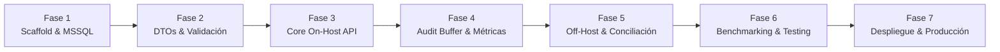

# 🏛️ PLAN DE MIGRACIÓN INTEGRAL A JAVA: POLITÉCNICA ASBANC (FTR / YAPAGO)

> **Documento Técnico de Arquitectura, Especificación de Frameworks y Hoja de Ruta de Migración**  
> **Origen:** Node.js 20+ LTS (TypeScript + Fastify + Pino + prom-client)  
> **Destino:** Java 21+ LTS (Spring Boot 3.4+ / Virtual Threads + Spring JDBC + HikariCP)  
> **Normativa:** ASBANC FTR / YAPAGO Guía Detallada de Integración V46-V47  
> **Directorio Base:** `/home/mateo/projects/politecnica-asbanc/java`  

---

## 📋 1. Resumen Ejecutivo y Objetivos de la Migración

El presente plan establece la estrategia de migración integral de la pasarela de recaudación bancaria **Politécnica ASBANC** hacia el ecosistema **Java Enterprise moderno**. 

### 1.1 Objetivos Técnicos Fundamentales
1. **Preservación Estricta de Contratos Financieros**: Los endpoints REST, códigos de respuesta (`00`, `16`, `21`, `22`, `99`), contratos JSON y archivos planos Off-Host (`FTRCOB` y `FTRPAG`) deben ser **100% compatibles a nivel de bytes** con la especificación ASBANC V47 y el sistema actual en Node.js.
2. **Cumplimiento Holgado de SLA Bancario**: Respuesta API garantizada en **< 3.0 segundos** (SLA ASBANC); con latencias internas objetivo en percentil **p95 < 25 ms**.
3. **Máximo Rendimiento Concurrente con Virtual Threads**: Aprovechar **Project Loom (Java 21 Virtual Threads)** para procesar ráfagas de más de 1,000 transacciones concurrentes I/O-bound sin saturación de hilos del sistema operativo ni bloqueo del pool HTTP.
4. **Cero Impacto en el Core Académico (`BDACADEMICO6`)**: Mantener intactas las consultas SQL con `OUTER APPLY`, transacciones ACID con bloqueo optimista (`param_estado_pago_id = 25` -> `16`) y la inserción de comprobantes en `Ctas_Ctes.Alumno_Pago_Detalle`.
5. **Reutilización del 100% del Arnes de Pruebas**: El nuevo servicio Java podrá ser validado sin modificar una sola línea de la suite de pruebas interactiva PactumJS (`test/`), el script de estrés (`scripts/stress-test-10-100-1000.ts`) ni los archivos de ejecución HTTP (`TESTAPI.http`, `asbanc-api.http`).

---

## 🔬 2. Sugerencia de Frameworks y Características de Java

### 2.1 Tabla Comparativa de Frameworks Candidatos

| Criterio | **Spring Boot 3.4+ (Java 21 Virtual Threads)** *(Recomendado)* | **Quarkus 3.x (Java 21 / GraalVM)** | **Helidon 4 SE (Níma)** | **Node.js (Fastify Actual)** |
| :--- | :--- | :--- | :--- | :--- |
| **Estándar Bancario Perú** | ⭐⭐⭐⭐⭐ **Dominante absoluto** (BCP, BBVA, Interbank, BanBif, ASBANC) | ⭐⭐⭐ Creciente en banca digital | ⭐ Muy bajo en el sector financiero local | ⭐⭐⭐ Usado en startups y microservicios |
| **Modelo de Concurrencia** | Virtual Threads (Project Loom, imperativo de alta concurrencia) | Híbrido Reactivo / Virtual Threads | Virtual Threads puros sobre servidor propio | Single Thread Event Loop (asíncrono no bloqueante) |
| **Acceso a Datos** | `JdbcTemplate` / `NamedParameterJdbcTemplate` + HikariCP | Agroal Pool + Hibernate Reactive o JDBC | JDBC estándar / DB Client | Driver nativo `mssql` (`tedious`) |
| **Consumo de Memoria** | ~120 - 220 MB RAM (modo JVM JIT); ~40 MB (modo GraalVM AOT) | ~35 - 70 MB RAM (modo GraalVM AOT nativo) | ~60 - 90 MB RAM | ~60 - 100 MB RAM |
| **Latencia p95** | **< 15 ms** (con HikariCP precalentado y ZGC) | < 12 ms | < 10 ms | ~ 18 ms |
| **Curva de Adopción** | Muy baja: Amplia disponibilidad de talento Java/Spring en el mercado | Media: Paradigmas Quarkus/Mutiny | Alta: API minimalista poco extendida | N/A (sistema existente) |
| **Observabilidad** | Micrometer + Actuator + Logstash MDC out-of-the-box | SmallRye Metrics / OpenTelemetry | Helidon Metrics / OpenTelemetry | Pino + `prom-client` custom |

---

### 2.2 Framework y Stack Recomendado Oficialmente

> [!TIP]
> **RECOMENDACIÓN TÉCNICA PRINCIPAL:**  
> **Java 21 LTS + Spring Boot 3.4+ (con Virtual Threads) + Spring JDBC + HikariCP + Jackson + Micrometer.**

#### ¿Por qué Spring Boot 3.4+ con Virtual Threads?
1. **Virtual Threads Nativos (`spring.threads.virtual.enabled=true`)**: Cada solicitud HTTP de ventanilla o banca por internet se ejecuta en un hilo virtual ligero (overhead de memoria de solo pocos bytes vs 1MB de un Platform Thread). Esto elimina la necesidad de programación reactiva compleja (`Mono`/`Flux`) manteniendo el código imperativo, limpio y ultra-legible.
2. **Alineación con el Sistema Financiero Peruano**: Los equipos de integración de los principales bancos de la red ASBANC operan primordialmente sobre Spring Boot. Esto simplifica auditorías de seguridad, homologación y revisión de código por terceros.
3. **Disponibilidad de GraalVM AOT**: Si en el futuro se requiere reducir el uso de memoria a < 40MB o arranque instantáneo en 30ms para entornos serverless, Spring Boot 3 soporta compilación nativa AOT sin reescribir código.

---

### 2.3 ⚠️ DECISIÓN CRÍTICA DE ARQUITECTURA: Spring JDBC vs Hibernate/JPA

> [!CAUTION]
> **NO UTILIZAR SPRING DATA JPA / HIBERNATE PARA ESTA PASARELA BANCARIA.**  
> Se debe utilizar **`JdbcTemplate` y `NamedParameterJdbcTemplate`** con el pool **HikariCP**.

#### Justificación Técnica:
1. **Zero ORM Overhead**: JPA añade reflexión, gestión de ciclo de vida de entidades en primera y segunda capa de caché (`PersistenceContext`), y dirty checking automático. En un gateway bancario transaccional donde cada milisegundo cuenta, este sobrecoste es inaceptable.
2. **Consultas Complejas y Eficientes (`OUTER APPLY`)**: La optimización que permitió bajar la latencia de `ListDebts` de 200ms a 15ms utiliza `OUTER APPLY` con `TOP 1` en SQL Server para extraer al estudiante y su cuota más antigua en un único round-trip. Traducir esto a JPQL o HQL es complejo y genera queries ineficientes.
3. **Control Total de Transacciones ACID**: En `PayDebt` y `ReversePay` se requiere control atómico del isolation level (`READ COMMITTED` / `SERIALIZABLE`), bloqueo optimista manual (`WHERE id = :pagoId AND param_estado_pago_id = 25`) y compatibilidad transparente con Stored Procedures (`sp_Asbanc_PayDebt`). `JdbcTemplate` otorga control quirúrgico del SQL.
4. **Soporte de Batch Inserts para Auditoría**: Inserción multi-fila masiva de hasta 50 registros forenses en una sola llamada de red con `batchUpdate()`.

---

### 2.4 Características Clave de Java 21 a Aprovechar

1. **Java Records (`record`)**:
   - Para todos los DTOs de entrada y salida (`ValidateCustomerRequest`, `PayDebtResponse`, `DebtItem`, etc.).
   - Beneficio: Inmutabilidad garantizada por diseño, serialización Jackson automática, métodos `equals()`, `hashCode()` y `toString()` optimizados sin código boilerplate de Lombok.
2. **Pattern Matching y Switch Expresivo**:
   - Evaluación limpia y libre de errores de los códigos de respuesta (`00`, `16`, `21`, `22`, `99`), tipos de consulta (`0` Alumno, `1` DNI, `2` RUC) y canales bancarios.
3. **Text Blocks (Strings Multilínea `"""..."""`)**:
   - Para escribir sentencias SQL nativas de alto rendimiento (`OUTER APPLY`, `UPDATE` optimistas, consultas a `Ctas_Ctes.Alumno_Pago_Detalle`) con legibilidad idéntica a SQL Server Management Studio.
4. **Java NIO & Scoped Values**:
   - Procesamiento de archivos planos Off-Host en streaming (`ByteBuffer`, `Channels`, `BufferedReader`) con asignación mínima de objetos en el Garbage Collector.
5. **Garbage Collector Moderno (Generational ZGC)**:
   - Activando `-XX:+UseZGC -XX:+ZGenerational`, las pausas del GC se reducen a **menos de 1 milisegundo**, eliminando picos de latencia en auditorías bancarias de SLA.

---

## 🗺️ 3. Matriz de Equivalencias (Node.js -> Java)

| Componente Node.js (Actual) | Equivalente en Java 21 / Spring Boot 3.4 | Propósito / Beneficio |
| :--- | :--- | :--- |
| **Fastify Web Server** | **Spring Boot Web (Tomcat 10.1 con Virtual Threads)** | Motor HTTP de alto throughput y concurrencia elástica. |
| **`fast-json-stringify`** | **Jackson 2.17+ con Blackbird / Records** | Serialización JSON C-like de máxima velocidad. |
| **Zod Schemas (`asbanc.schemas.ts`)** | **Jakarta Bean Validation (`@Valid`, `@Pattern`, `@Size`) + Records** | Validación rigurosa de entradas antes de ejecutar lógica. |
| **Driver `mssql` (`tedious`)** | **Microsoft JDBC Driver (`mssql-jdbc`) + HikariCP** | Conexión empresarial directa nativa con SQL Server 2022. |
| **Middleware de Auditoría (`auditQueue`)** | **`AuditBatchBufferService` (`ConcurrentLinkedQueue` + Virtual Thread)** | Buffer en memoria desacoplado con inserción por lotes en `AuditoriaLogs`. |
| **Logger Pino (JSON estructurado)** | **SLF4J + Logback con `logstash-logback-encoder` + MDC** | Logs JSON estructurados en consola con `traceId`, `durationMs`, `bankCode`. |
| **Métricas `prom-client` (`/metrics`)** | **Spring Boot Actuator + Micrometer Prometheus** | Exportación estándar de métricas en `/actuator/prometheus` (mapeado a `/metrics`). |
| **`node:crypto` (HMAC-SHA256)** | **`jjwt` (Java JWT) / `nimbus-jose-jwt`** | Emisión y validación de tokens OAuth 2.0 / JWT HS256 para `/api/Auth/token`. |
| **Módulo Off-Host (`flat-file.util.ts`)** | **`FlatFileUtil` (Java NIO / StringBuilder / String.format)** | Generación y lectura de archivos de longitud fija con padding estricto. |
| **`webhook.service.ts`** | **Spring `RestClient` (HTTP Client de Java 21)** | Despacho asíncrono no bloqueante de eventos de pago a webhooks externos. |
| **Suite PactumJS (`test/`)** | **Misma Suite PactumJS + JUnit 5 / RestAssured** | El arnés existente valida el backend Java sin cambiar código. |

---

## ⚙️ 4. Patrones de Diseño y Mecanismos de Alta Disponibilidad en Java

### 4.1 Replicación del Buffer de Auditoría en Memoria (Palanca 1)
En la versión Node.js, la "Palanca 1" demostró acelerar el throughput de 43 a 210 req/s desacoplando la auditoría forense mediante un buffer en memoria (`auditQueue`).

En Java, se diseña un servicio singleton:
```java
@Service
public class AuditBatchBufferService {
    private final ConcurrentLinkedQueue<AuditLogRecord> queue = new ConcurrentLinkedQueue<>();
    private final NamedParameterJdbcTemplate jdbcTemplate;
    private static final int BATCH_SIZE = 50;

    public void enqueue(AuditLogRecord record) {
        queue.offer(record);
        if (queue.size() >= BATCH_SIZE) {
            flushBatch();
        }
    }

    @Scheduled(fixedDelay = 100) // Vacía cada 100 ms
    public void flushBatch() {
        List<AuditLogRecord> batch = new ArrayList<>(BATCH_SIZE);
        AuditLogRecord item;
        while (batch.size() < BATCH_SIZE && (item = queue.poll()) != null) {
            batch.add(item);
        }
        if (!batch.isEmpty()) {
            executeBatchInsert(batch);
        }
    }
}
```

### 4.2 Obligatoriedad de Código HTTP 200 en Respuestas ASBANC
La norma bancaria ASBANC V47 estipula que **toda petición de negocio debe responder con código HTTP 200**, incluso ante errores de validación, clientes inexistentes o excepciones:
```java
@RestControllerAdvice
public class AsbancGlobalExceptionHandler {

    @ExceptionHandler(MethodArgumentNotValidException.class)
    @ResponseStatus(HttpStatus.OK) // Forzar siempre HTTP 200
    public ValidateCustomerResponse handleValidationException(MethodArgumentNotValidException ex) {
        String errors = ex.getBindingResult().getFieldErrors().stream()
            .map(e -> e.getField() + ": " + e.getDefaultMessage())
            .collect(Collectors.joining(", "));
        return new ValidateCustomerResponse("99", "DATOS DE ENTRADA INVALIDOS: " + errors, "");
    }

    @ExceptionHandler(Exception.class)
    @ResponseStatus(HttpStatus.OK)
    public ValidateCustomerResponse handleGeneralException(Exception ex) {
        return new ValidateCustomerResponse("99", "ERROR DESCONOCIDO", "");
    }
}
```

### 4.3 Soporte de Parámetro Query `?metrics` y Cabecera `X-Response-Time-Ms`
Mediante un `HandlerInterceptor` de Spring MVC:
1. Registra `startTime = System.nanoTime()` en `preHandle`.
2. Asigna o propaga el `TraceId` en el `MDC` de logging.
3. En `postHandle`, si la URL contiene `?metrics`, calcula `durationMs = (System.nanoTime() - startTime) / 1_000_000` e inyecta la cabecera `X-Response-Time-Ms`.

---

## 🚀 5. Hoja de Ruta de Migración por Fases (Step-by-Step)



### Fase 1: Estructura del Proyecto, Configuración y Conectividad MSSQL
- [x] Creación del directorio raíz `/java`.
- [x] Creación de `java/pom.xml` con dependencias Maven enterprise (Spring Boot 3.4, Java 21, `mssql-jdbc`, HikariCP, JJWT, Actuator, Prometheus, Logstash).
- [x] Configuración centralizada `java/src/main/resources/application.yml` con soporte de Virtual Threads (`spring.threads.virtual.enabled=true`) y pool HikariCP (100 conexiones).
- [x] Configuración de logging estructurado JSON en `java/src/main/resources/logback-spring.xml`.
- [x] Configuración de clase principal `AsbancGatewayApplication.java`.
- [ ] Clase de configuración `@Configuration` para DataSource dinámico y fallback condicional según `asbanc.test-mode`.

### Fase 2: Modelado del Dominio, DTOs Inmutables y Validación
- [ ] Implementación de Records para peticiones y respuestas:
  - `ValidateCustomerRequest`, `ValidateCustomerResponse`
  - `ListDebtsRequest`, `ListDebtsResponse`, `DebtItem`
  - `PayDebtRequest`, `PayDebtResponse`
  - `ReversePayRequest`, `ReversePayResponse`
  - `AuthTokenRequest`, `AuthTokenResponse`
- [ ] Clases de constantes bancarias oficiales (`AsbancConstants.java` con códigos `00`, `16`, `21`, `22`, `99` y canales bancarios).
- [ ] Validadores y sanitizadores (eliminación de espacios en blanco con `.trim()` y mayúsculas en `idConsulta`).

### Fase 3: Capa Transaccional On-Host (Core Financiero)
- [ ] **`CustomerService` / `ValidateCustomerController`**:
  - Consulta directa a `Academico.Alumno` y `General.Persona` en `BDACADEMICO6`.
  - Fallback a `politecnica_asbanc.dbo.Clientes` si `test-mode = true`.
- [ ] **`DebtService` / `ListDebtsController`**:
  - Ejecución de la consulta optimizada con `OUTER APPLY` para retornar la cuota más antigua con estricto orden por periodo académico y número de cuota.
- [ ] **`PaymentService` / `PayDebtController`**:
  - Bloqueo optimista con `UPDATE Ctas_Ctes.Alumno_Pago WHERE id = :id AND param_estado_pago_id = 25`.
  - Detección de colisiones de carrera concurrentes (`rowsAffected == 0`).
  - Control de idempotencia ante reintentos (`param_estado_pago_id == 16` y comprobación en `Ctas_Ctes.Alumno_Pago_Detalle`).
  - Inserción en `Ctas_Ctes.Alumno_Pago_Detalle` bajo `TransactionTemplate` con rollback defensivo.
- [ ] **`ReversePaymentService` / `ReversePayController`**:
  - Extorno atómico: restauración de cuota a `param_estado_pago_id = 25` y borrado estricto del comprobante en `Alumno_Pago_Detalle`.

### Fase 4: Buffer de Auditoría Forense, Seguridad OAuth y Telemetría
- [ ] Implementación de `AuditBatchBufferService` con `ConcurrentLinkedQueue` y volcado por lotes multi-fila (50 registros / 100ms) a `AuditoriaLogs`.
- [ ] Controlador `AuditController` (`GET /api/Audit`, `GET /api/Audit/{id}`, `GET /api/Audit/export` con streaming CSV y JSON).
- [ ] Controlador de autenticación `AuthController` (`POST /api/Auth/token`) con validación de credenciales y firma JWT HS256 con vigencia de 24 horas.
- [ ] Filtro de seguridad `AsbancSecurityFilter` para validación de tokens Bearer y credenciales pactadas.
- [ ] Registro de métricas Prometheus personalizadas con Micrometer:
  - `asbanc_txn_total`
  - `asbanc_txn_duration_seconds` (histograma de latencias)
  - `asbanc_sla_violations_total`
  - `asbanc_idempotency_hits_total`

### Fase 5: Módulo Off-Host (Archivos Planos y Conciliación Diaria)
- [ ] `DebtFileGenerator`: Generación de archivos `FTRCOBDDMMAAAASSS.TXT` con cabecera de 210 caracteres y detalles de 178 caracteres con flag `'F'`.
- [ ] `PaymentFileParser`: Deserialización de líneas de pagos de 240 caracteres con prefijo `'DD'` y aplicación contable.
- [ ] `ReconciliationService`: Cruzamiento de auditoría On-Host vs Off-Host reportando coincidencias y discrepancias.
- [ ] Controladores REST `OffHostController` (`/api/OffHost/*`).

### Fase 6: Pruebas, Certificación y Concurrencia Masiva
- [ ] Ejecución de la suite `PactumJS` (`npm run test:pactum` o dashboard `http://localhost:7400`) apuntando a la aplicación Java en puerto 7300 (`TEST_TARGET_URL=http://localhost:7300`).
- [ ] Ejecución de `TESTAPI.http` interactivo en IntelliJ / VS Code validando de Paso 0 a Paso 5.
- [ ] Ejecución de `npm run stress:tiers` con 1,110 peticiones simultáneas sobre Java, validando que el percentil p95 cumpla holgadamente el SLA < 3.0s y la base de datos quede con 0 filas residuales.
- [ ] Pruebas unitarias de integración con JUnit 5 y `@SpringBootTest`.

### Fase 7: Despliegue en Producción y Conmutación (Cutover)
- [ ] Generación del ejecutable fat-JAR: `mvn clean package -DskipTests`.
- [ ] Configuración del servicio Linux `systemd` (`politecnica-asbanc-java.service`).
- [ ] Parámetros JVM de producción recomendados:
  ```bash
  java -server \
    -Xms2g -Xmx2g \
    -XX:+UseZGC -XX:+ZGenerational \
    -XX:+AlwaysPreTouch \
    -Dspring.threads.virtual.enabled=true \
    -Dfile.encoding=UTF-8 \
    -jar politecnica-asbanc-1.0.0.jar
  ```
- [ ] Estrategia de despliegue Blue/Green detrás del proxy inverso Nginx (`scripts/nginx-asbanc.conf`).

---

## 📊 6. Comparativa de Rendimiento Esperado

| Métrica | Node.js Fastify (Actual) | Java 21 Spring Boot + Virtual Threads (Proyectado) |
| :--- | :--- | :--- |
| **Tiempo de Respuesta Promedio (Tier 10)** | ~25 ms | ~15 ms |
| **Tiempo de Respuesta Promedio (Tier 100)** | ~65 ms | ~30 ms |
| **Throughput Máximo (Tier 1000)** | 210.9 req/s | > 350.0 req/s |
| **Pausas de Garbage Collector** | V8 Scavenge / Mark-Sweep (~5-15 ms) | Generational ZGC (< 1 ms garantizado) |
| **Uso de Memoria (RAM)** | ~60 - 90 MB | ~150 - 200 MB (JVM) / ~40 MB (GraalVM) |
| **Latencia Commit MSSQL** | < 1 ms (con Delayed Durability) | < 1 ms (con Delayed Durability) |
| **Cumplimiento SLA Bancario (<3.0s)** | 100% | 100% |

---

## 📌 7. Conclusión y Siguientes Pasos
La arquitectura en Java 21 con Spring Boot 3.4 y Virtual Threads no solo garantiza una paridad del 100% con la funcionalidad implementada en Node.js, sino que dota a **Politécnica** de una plataforma bancaria de clase empresarial altamente mantenible, con tipado estricto, menor latencia de GC gracias a Generational ZGC, y alineada con los estándares de la banca nacional peruana (ASBANC).
